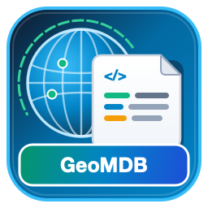

# GeoMDB - ISO 19115-3 / ISO 19139 Spatial Metadata Editor

**GeoMDB - Metadata Editor** adalah plugin resmi QGIS untuk membuat, menyunting, memvalidasi, dan mengekspor metadata spasial berbasis standar internasional **ISO 19115-3** dan **ISO 19139 (gmd)** yang kompatibel penuh dengan Geoportal Nasional (BIG / Palapa) serta pycsw CSW-T.

## 📌 Fitur Utama

- **13 Tahapan Lengkap Metadata Spasial**:
  1. Informasi Metadata
  2. Identitas Data
  3. Representasi Spasial (Vektor & Raster)
  4. Sistem Referensi Koordinat (SRS/CRS)
  5. Informasi Konten & Katalog Fitur
  6. Distribusi & Akses Data (WMS, WFS, URL Unduhan)
  7. Kualitas Data & Uji Kesesuaian
  8. Riwayat Data (Lineage & Process Steps)
  9. Katalog Penyajian (Portrayal)
  10. Batasan & Keamanan
  11. Skema Aplikasi
  12. Pemeliharaan Data & Metadata
  13. Ekstensi Metadata

- **Ekstraksi Otomatis dari Layer QGIS Aktif**:
  - Judul layer, format (Vektor/Raster), sistem koordinat (EPSG code & codeSpace), resolusi/skala spasial, tipe geometri/topologi, dan batas wilayah (Bounding Box BBOX) dapat langsung ditarik otomatis dari layer yang sedang aktif di QGIS canvas.

- **Dua Standar Ekspor XML**:
  - **ISO 19115-3 (Namespace mdb)**: Format standar terbaru untuk integrasi sistem dan validasi profil nasional.
  - **ISO 19139 (Namespace gmd)**: Format standar interoperabilitas katalog OGC CSW dan siap diimpor ke **pycsw / Geoportal Palapa Simpul Jaringan**.

- **Validasi Kelengkapan Data**:
  - Pengecekan atribut wajib, format tanggal (ISO 8601), struktur kontak penanggung jawab/walidata, dan status pengisian per seksi secara visual.

- **Fitur Draft & Template**:
  - Kemampuan Simpan (Save) dan Buka Berkas (Load) berkas XML metadata baik format ISO 19115-3 maupun ISO 19139.

## 💻 Kebutuhan Sistem

- **QGIS**: Versi 3.0 ke atas (diuji dan didukung penuh pada QGIS 3.22, 3.28, 3.34 LTR, dan QGIS 3.40+).
- **Sistem Operasi**: Windows, macOS, Linux.
- **Python**: 3.7+ (bawaan dari instalasi QGIS).

## 🚀 Cara Instalasi

### Metode 1: Dari QGIS Python Plugins Repository (Rekomendasi)
1. Buka aplikasi **QGIS**.
2. Masuk ke menu **Plugins** > **Manage and Install Plugins...**
3. Pada tab **All**, cari `GeoMDB - Metadata Editor`.
4. Klik **Install Plugin**.

### Metode 2: Instalasi Manual dari Berkas ZIP
1. Unduh berkas `iso19115_metadata_editor.zip`.
2. Buka **QGIS** > menu **Plugins** > **Manage and Install Plugins...**
3. Pilih tab **Install from ZIP**.
4. Arahkan ke berkas ZIP yang diunduh lalu klik **Install Plugin**.

## 📖 Cara Penggunaan

1. Klik ikon **GeoMDB** pada toolbar QGIS atau menu **Plugins** > **GeoMDB - Metadata Editor**.
2. Klik tombol **Ambil Data Layer Aktif** jika ingin mengekstrak informasi bounding box dan proyeksi dari peta layer yang sedang dibuka.
3. Lengkapi formulir metadata pada masing-masing seksi (Tahap 1 hingga Tahap 13).
4. Klik **Validasi** untuk memastikan elemen wajib telah terisi dengan benar.
5. Ekspor metadata menggunakan tombol:
   - **Simpan / Ekspor ISO 19115-3** (format xml mdb).
   - **Ekspor ISO 19139 (GMD)** (format xml gmd untuk pycsw / Geoportal).

## 📄 Lisensi

Plugin ini berlisensi bebas dan terbuka di bawah lisensi [GNU General Public License v3.0 (GPLv3)](LICENSE).

## 👥 Pengembang & Kontributor

- **Wendra**
- **Hari Kurniadi**
- **Andre Bejo**
