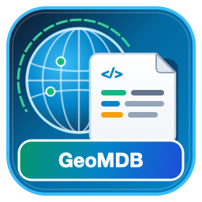

# GeoMDB - ISO 19115-3 / ISO 19139 Spatial Metadata Editor

**GeoMDB - Metadata Editor** adalah plugin resmi QGIS untuk membuat, menyunting, memvalidasi, dan mengekspor metadata spasial berbasis standar internasional **ISO 19115-3** dan **ISO 19139 (gmd)** yang kompatibel penuh dengan Geoportal Nasional (BIG / Palapa) serta pycsw CSW-T.

## 📌 Fitur Utama

- **13 Tahapan Lengkap Metadata Spasial**:
  1. Informasi Metadata
  2. Identitas Data
  3. Representasi Spasial (Vektor & Raster)
  4. Sistem Referensi Koordinat (SRS/CRS)
  5. Informasi Konten & Katalog Fitur
  6. Distribusi & Akses Data (WMS, WFS, URL Unduhan)
  7. Kualitas Data & Uji Kesesuaian
  8. Riwayat Data (Lineage & Process Steps)
  9. Katalog Penyajian (Portrayal)
  10. Batasan & Keamanan
  11. Skema Aplikasi
  12. Pemeliharaan Data & Metadata
  13. Ekstensi Metadata

- **Ekstraksi Otomatis dari Layer QGIS Aktif**:
  - Judul, abstrak, kata kunci, kontak (dari metadata layer QGIS), format, sistem koordinat (EPSG code & codeSpace), tipe & jumlah geometri, ukuran berkas, dan batas wilayah (Bounding Box, otomatis ke WGS 84) dapat langsung ditarik dari layer vektor yang dipilih di QGIS.

- **Dua Standar Ekspor XML**:
  - **ISO 19115-3 (Namespace mdb)**: Format standar terbaru untuk integrasi sistem dan validasi profil nasional. Format yang diterima **Geoportal Palapa 5.1** (berkas hasil **Simpan** dengan **Kompatibel Sistem BIG** dicentang); Palapa 5.0 belum mendukungnya.
  - **ISO 19139 (Namespace gmd)**: Format standar interoperabilitas katalog OGC CSW dan siap diimpor ke **pycsw / Geoportal Palapa Simpul Jaringan** (untuk Palapa 5.0; Palapa 5.1 tidak menerima ISO 19139).

- **Validasi Kelengkapan Data**:
  - Pengecekan atribut wajib, format tanggal (ISO 8601), struktur kontak penanggung jawab/walidata, dan status pengisian per seksi secara visual.

- **Fitur Draft & Template**:
  - Kemampuan Simpan (Save) dan Buka Berkas (Load) berkas XML metadata baik format ISO 19115-3 maupun ISO 19139.

## 💻 Kebutuhan Sistem

- **QGIS**: Versi 3.0 ke atas (diuji dan didukung penuh pada QGIS 3.22, 3.28, 3.34 LTR, dan QGIS 3.40+).
- **Sistem Operasi**: Windows, macOS, Linux.
- **Python**: 3.7+ (bawaan dari instalasi QGIS).

## 🚀 Cara Instalasi

### Metode 1: Dari QGIS Python Plugins Repository (Rekomendasi)
1. Buka aplikasi **QGIS**.
2. Masuk ke menu **Plugins** > **Manage and Install Plugins...**
3. Pada tab **All**, cari `GeoMDB - Metadata Editor`.
4. Klik **Install Plugin**.

### Metode 2: Instalasi Manual dari Berkas ZIP
1. Unduh berkas `iso19115_metadata_editor.zip`.
2. Buka **QGIS** > menu **Plugins** > **Manage and Install Plugins...**
3. Pilih tab **Install from ZIP**.
4. Arahkan ke berkas ZIP yang diunduh lalu klik **Install Plugin**.

## 📖 Cara Penggunaan

1. Klik ikon **GeoMDB** pada toolbar QGIS atau menu **Plugins** > **GeoMDB - Metadata Editor**.
2. Klik tombol **Ambil Metadata dari Layer Aktif** untuk mengisi otomatis judul, cakupan wilayah, sistem koordinat, geometri, format, dan isian lain dari layer **vektor** yang dipilih (layer raster diisi manual).
3. Lengkapi formulir metadata pada masing-masing seksi (Tahap 1 hingga Tahap 13).
4. Klik **✓ Validasi Isian** untuk melihat isian yang masih kosong per tahapan.
5. Simpan dan ekspor:
   - **💾 Simpan** / **📁 Simpan Sebagai...**: berkas kerja ISO 19115-3 (mdb).
   - **🌐 Export ISO 19139 (gmd) ▾**: *Untuk Palapa / CSW* (pycsw / Geoportal Palapa 5.0) atau *Untuk GeoNode – Upload Metadata*.

**Panduan lengkap** (PowerPoint, 18 sesi: instalasi sampai contoh pengisian berbagai kondisi): [docs/Panduan-GeoMDB-Metadata-Editor.pptx](docs/Panduan-GeoMDB-Metadata-Editor.pptx).

## ☁️ Sinkronisasi dengan GeoNode

Metadata dataset GeoNode bisa diambil ke formulir, disunting, lalu dikirim balik (ISO 19139) dengan akun
GeoNode masing-masing pengguna; CSW GeoNode ikut terbarui.

**Login:** username & password akun GeoNode masing-masing, tersimpan terenkripsi di Authentication Manager QGIS.
Tidak perlu persiapan admin; cukup beri group/pengguna izin *ubah metadata* hanya pada dataset miliknya.

| Dataset | Yang bisa dilakukan |
|---|---|
| Sudah dipublikasikan | ambil, perbarui, cadangan, pemeriksaan CSW |
| Belum dipublikasikan | hanya perbarui. CSW GeoNode tidak mengenali login username/password, jadi ambil, cadangan & pemeriksaan CSW tidak bisa. Gantinya: unduh XML dataset lewat *Download → ISO Metadata* di browser (sambil login GeoNode) lalu buka dengan **Buka XML Metadata...** |

Akun SSO/LDAP yang tidak punya password lokal GeoNode tidak bisa dipakai.

**Pengguna:**
1. Klik **Ambil dari GeoNode...** di bagian atas editor dan isi URL GeoNode. Klik **Login username/password…**
   (username & password akun GeoNode), lalu **Masuk & muat dataset**.
2. Telusuri katalog dalam mode **Kartu** (thumbnail) atau **Daftar** (tabel, bisa diurutkan). Memilih dataset
   menampilkan pratinjau peta dari layanan WMS-nya di atas peta dasar OpenStreetMap. Dataset yang tidak boleh
   diubah akun Anda ditandai *Hanya lihat*.
3. **Ambil ke formulir** (atau klik ganda) — record ISO dataset dari CSW GeoNode dimuat ke formulir dan editor
   tertaut ke dataset itu.
4. Sunting isian, lalu **☁ Kirim ke GeoNode...** di bawah formulir → dataset tertaut terpilih otomatis (bertanda
   *Asal formulir*; daftar kartu/daftar yang sama dengan katalog) → **Perbarui di GeoNode**. Klik ganda di dialog
   ini tidak mengirim apa pun.

**Dua mode pengiriman:**
- **Mode biasa (bawaan)**: GeoNode memperbarui kolom yang dikenalnya (judul, abstrak, kata kunci, …) dan membuat
  ulang record CSW dari templatenya. Aman di semua GeoNode. Metadata lengkap tetap di berkas GeoMDB.
- **Mode preserve** (`metadata_uploaded_preserve`): CSW GeoNode menyajikan XML GeoMDB apa adanya, termasuk kontak,
  riwayat/langkah proses, laporan kualitas, batasan, dsb. Tautan WMS/WFS/unduhan & thumbnail GeoNode disisipkan
  otomatis. Hanya dipakai bila **"Server GeoNode ini sudah ditambal"** dicentang, karena GeoNode 4.2.5 s.d. versi
  terbaru punya bug yang merusak record ber-preserve. Admin server memasang tambalannya dengan
  **[alat tambal GeoNode](https://github.com/hariHK1/geonode-tambal-preserve)**.

Plugin **mendeteksi server yang belum ditambal**:
- saat daftar dataset dimuat, record CSW rusak pada dataset ber-preserve memunculkan peringatan dan link alat tambal;
- saat mengirim dengan preserve, gejala bug membuat plugin otomatis mematikan preserve, mengirim ulang tanpa
  preserve (record CSW sehat kembali), lalu menandai server "belum ditambal".

Dengan mode preserve, CSW menyajikan XML unggahan terakhir, jadi sunting metadata dataset itu lewat GeoMDB
(ambil → sunting → perbarui), bukan lewat form GeoNode. Setelah unggah, plugin memeriksa record CSW dan isian
GeoNode, lalu memperingatkan bila XML belum diterapkan.

Metadata yang diambil dari GeoNode dimuat ke formulir yang **dikosongkan dulu dari nilai bawaan template plugin**,
dan teks pengisi template GeoNode ("None", "No abstract provided") dibuang, sehingga yang tampil hanya data GeoNode.
Lisensi, DOI, batasan lain, dan informasi tambahan GeoNode ikut terbawa. `dateStamp` diisi tanggal dataset GeoNode,
karena GeoNode mengisi tanggal dataset dari `dateStamp` (tanggalnya jadi tidak berubah).

**Pengaman salah-tujuan** (GeoNode tidak punya *undo*):
- Formulir hasil *Ambil dari GeoNode* dikunci ke dataset asalnya; tujuan lain hanya lewat **Ganti dataset tujuan…**.
- Mengirim ke dataset yang bukan asal formulir wajib konfirmasi dengan **mengetik nama layer** tujuan.
- Sebelum menimpa, metadata lama disimpan di `<profil QGIS>/geomdb_cadangan/<host>/<pk>-<layer>/` dan bisa
  dikembalikan dengan **Pulihkan dari cadangan…** (hanya ke dataset asalnya, tanpa preserve, tanggal dataset
  semula). Ini juga cara memperbaiki record CSW yang rusak oleh bug preserve.
- Bila cakupan/sistem referensi formulir berbeda dengan GeoNode saat ini, plugin menanyakan nilai mana yang dikirim.
- *Ambil Metadata dari Layer Aktif* pada formulir tertaut memperingatkan bahwa isiannya ikut terkirim ke dataset itu.

**Versi GeoNode** dideteksi otomatis dari URL (tanpa login) atau dipilih manual:

| Versi | Ambil | Perbarui | Preserve |
|---|---|---|---|
| GeoNode 5.x, 4.4 | ✓ | ✓ | diatur plugin (server harus sudah ditambal) |
| GeoNode 4.2.3 – 4.3 | ✓ | ✓ | hanya lewat Django admin → Datasets → *Metadata uploaded preserve* (server harus sudah ditambal) |
| GeoNode 4.0 – 4.2.2 | ✓ | ✗ (belum ada API unggah XML) | – |

**GeoNode di balik Cloudflare / WAF:** cek bot (mis. Cloudflare *Managed Challenge*, *Bot Fight Mode*, *I'm Under
Attack*) bisa menolak permintaan QGIS sebelum sampai ke GeoNode, padahal situsnya terbuka di browser. Plugin
mengenalinya dan menampilkan "dihadang cek bot", bukan "password salah". Solusinya ada di pengelola Cloudflare
server: kecualikan path `/api/`, `/catalogue/csw`, dan `/geoserver/` dari cek bot (path ini juga
dipakai klien WMS dan harvester CSW, mis. Ina-Geoportal), atau izinkan jaringan tertentu (*IP Access Rules →
Allow*, mis. per ASN). Berpindah jaringan tidak bisa diandalkan.

## 📄 Lisensi

Plugin ini berlisensi bebas dan terbuka di bawah lisensi [GNU General Public License v3.0 (GPLv3)](LICENSE).

## 👥 Pengembang & Kontributor

- **Wendra**
- **Hari Kurniadi**
- **Andre Bejo**
