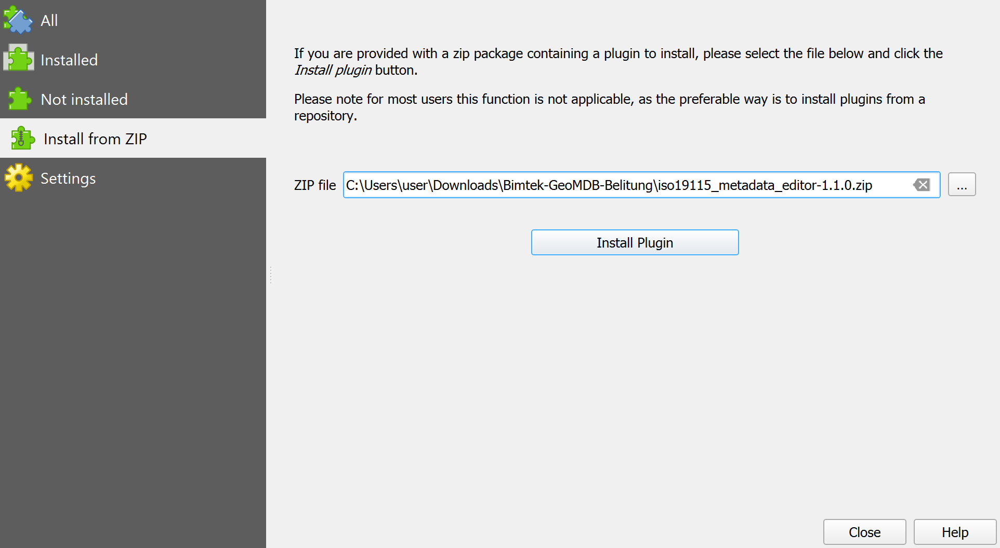
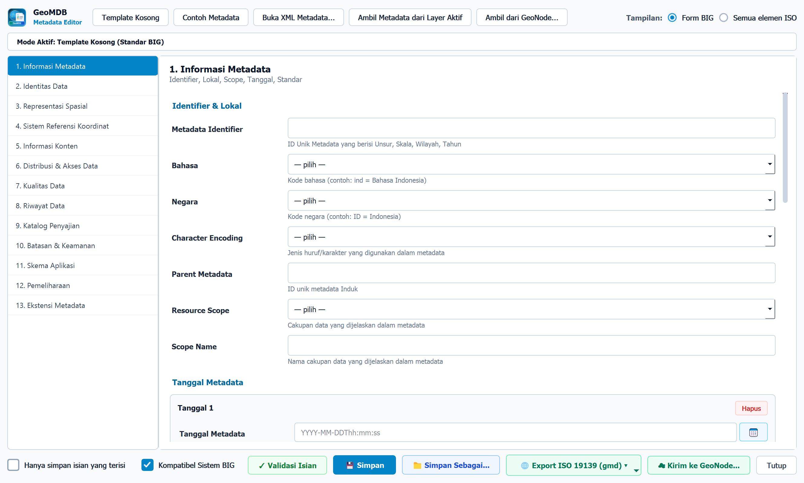

# Sesi 01 – Instalasi & pembaruan

**Tujuan:** plugin GeoMDB 1.1.0 terpasang di QGIS dan bisa dibuka.
**Waktu:** ±15 menit.

## Kebutuhan

| Komponen | Keterangan |
|---|---|
| QGIS | 3.0 sampai 4.x. Diuji pada QGIS 3.40 LTR |
| Sistem operasi | Windows, macOS, atau Linux |
| Internet | Hanya untuk fitur GeoNode (sesi 15–16) dan peta dasar pratinjau. Mengisi, menyimpan, dan mengekspor metadata bisa luring |

## Cara A – dari repositori plugin QGIS

1. Buka QGIS, pilih **Plugins › Manage and Install Plugins…**.
2. Pada tab **All**, ketik `GeoMDB` di kotak pencarian.
3. Pilih **GeoMDB - Metadata Editor**, periksa nomor versinya di panel kanan, lalu klik **Install Plugin**.

> Fitur di panduan ini membutuhkan versi **1.1.0**. Bila repositori masih menampilkan versi lebih lama (mis. 1.0.5),
> pakai Cara B.

## Cara B – dari berkas ZIP

1. Siapkan berkas ZIP plugin, misalnya `iso19115_metadata_editor-1.1.0.zip` (dibagikan pengelola/panitia, atau
   dibuat sendiri dari repositori, lihat di bawah).
2. Buka **Plugins › Manage and Install Plugins…**, pilih tab **Install from ZIP**.
3. Klik tombol **…** di samping **ZIP file**, pilih berkas ZIP.
4. Klik **Install Plugin**. Bila muncul peringatan keamanan tentang plugin dari sumber yang tidak dikenal, pilih
   **Yes** hanya bila berkas ZIP berasal dari sumber yang Anda percayai.
5. Tunggu pesan berhasil, lalu tutup jendela.



### Membuat ZIP sendiri dari repositori

QGIS hanya bisa memuat plugin bila ZIP berisi **folder bernama `iso19115_metadata_editor`**. Tombol *Download ZIP*
di GitHub menghasilkan folder `iso19115_metadata_editor-<nama-cabang>`. Nama itu mengandung tanda hubung,
sehingga plugin **gagal dimuat**. Pilih salah satu cara berikut:

- Dengan git, dari dalam folder repositori:

  ```
  git archive --format=zip --prefix=iso19115_metadata_editor/ -o iso19115_metadata_editor.zip HEAD
  ```

- Tanpa git: ekstrak ZIP dari GitHub, ganti nama foldernya menjadi `iso19115_metadata_editor`, lalu kompres
  ulang folder itu menjadi ZIP.

## Membuka plugin

Pilih salah satu:

- Klik ikon **GeoMDB** di toolbar QGIS, atau
- Menu **Plugins › GeoMDB - Metadata Editor › GeoMDB - Metadata Editor**.

Jendela editor terbuka dengan formulir **Template Kosong**:



Pastikan versinya benar di **Plugins › Manage and Install Plugins… › Installed › GeoMDB - Metadata Editor**.

## Memperbarui ke versi baru

Pasang ZIP versi baru dengan **Install from ZIP** (Cara B). QGIS mengganti seluruh folder plugin lama.

> **Penting – cadangkan Kontak Tersimpan sebelum memperbarui.** Daftar kontak tersimpan (sesi 04) berada di
> berkas `contacts_presets.json` di dalam folder plugin, sehingga ikut terganti saat plugin diperbarui.
> Cara mencadangkannya:
>
> 1. **Settings › User Profiles › Open Active Profile Folder**.
> 2. Buka `python/plugins/iso19115_metadata_editor/`, salin `contacts_presets.json` ke tempat lain.
> 3. Setelah pembaruan, salin kembali berkas itu ke folder yang sama, lalu tutup dan buka lagi jendela GeoMDB.

Setelah memperbarui, sebaiknya tutup dan buka kembali QGIS agar seluruh modul baru termuat.

## Menghapus plugin

**Plugins › Manage and Install Plugins… › Installed**, pilih **GeoMDB - Metadata Editor**, klik
**Uninstall Plugin**. Berkas XML metadata yang sudah Anda simpan tidak ikut terhapus.

## Kondisi khusus

| Kondisi | Yang dilakukan |
|---|---|
| Ikon tidak muncul setelah instalasi | Di tab **Installed**, pastikan kotak centang di depan **GeoMDB - Metadata Editor** aktif. Bila toolbar tersembunyi, aktifkan lewat **View › Toolbars › Plugins Toolbar** |
| Muncul galat Python saat QGIS dibuka (mis. *No module named …*) | Biasanya karena nama folder di dalam ZIP salah. Hapus plugin, buat ZIP dengan cara di atas, lalu pasang ulang |
| Versi lama (1.0.5) masih terpasang | Pasang ZIP 1.1.0 dengan **Install from ZIP**; versi lama otomatis tergantikan |
| Komputer tanpa internet | Cara B bisa dipakai luring; cukup salin ZIP lewat flashdisk |
| Kebijakan kantor melarang plugin dari ZIP | Minta admin TI memasangkan, atau tunggu versi 1.1.0 tersedia di repositori plugin QGIS |

> **Untuk pengembang:** jangan memasang plugin ke QGIS dengan *symlink/junction* yang menunjuk ke folder repositori
> lalu memakai **Install from ZIP**. QGIS menghapus isi folder plugin lama sebelum mengekstrak, sehingga isi
> repositori ikut terhapus. Untuk pengembangan, salin folder hasil `git archive` atau pakai plugin *Plugin Reloader*
> pada salinan terpisah.

**Lanjut ke:** [Sesi 02 – Mengenal editor](02-mengenal-editor.md)
