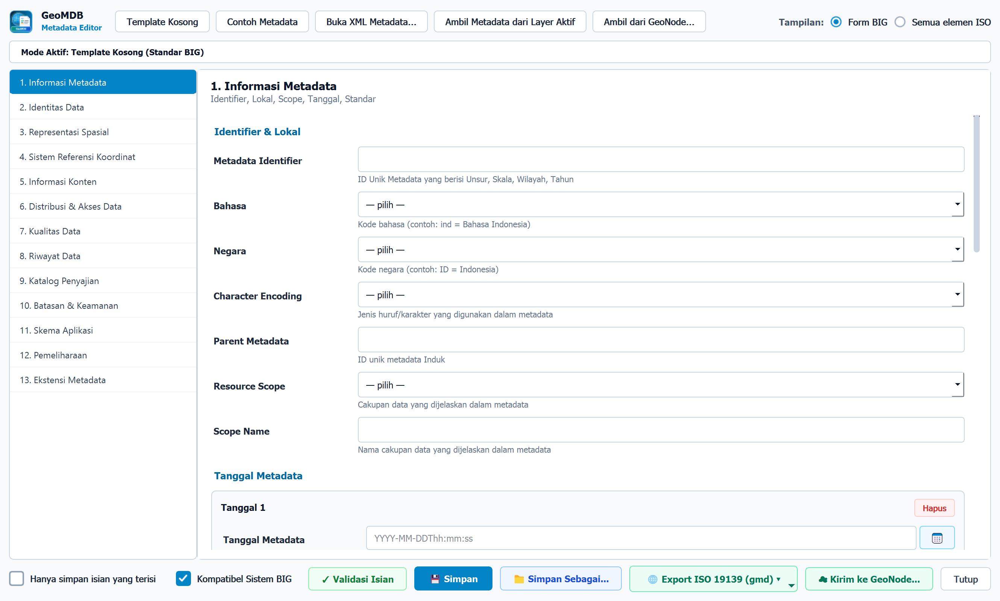

# Sesi 02 – Mengenal editor

**Tujuan:** memahami bagian-bagian jendela GeoMDB, jenis kolom isian, dan ke-13 tahapan metadata.
**Waktu:** ±20 menit.

## Bagian layar

| Bagian | Letak | Fungsi |
|---|---|---|
| **Tombol header** | Baris atas | Memulai atau memuat metadata: **Template Kosong**, **Contoh Metadata**, **Buka XML Metadata…**, **Ambil Metadata dari Layer Aktif**, **Ambil dari GeoNode…** (sesi 03 dan 15) |
| **Tampilan** | Kanan atas | **Form BIG** (bawaan) atau **Semua elemen ISO** (lihat di bawah) |
| **Baris status** | Di bawah header | Menunjukkan sumber isian: `Mode Aktif: Template Kosong (Standar BIG)`, `Berkas Aktif: <lokasi berkas>`, tanda `[Format ISO 19139 (gmd) Diimpor]`, atau `Tertaut ke GeoNode: …` |
| **Daftar tahapan** | Kolom kiri | 13 tahapan metadata. Setelah validasi atau simpan, tiap tahapan diberi tanda `(n kosong)` atau `✓` |
| **Panel isian** | Kanan | Kolom isian tahapan terpilih, dikelompokkan dengan judul biru. Di bawah tiap kolom ada keterangan singkat cara mengisinya |
| **Baris tombol bawah** | Paling bawah | **Hanya simpan isian yang terisi**, **Kompatibel Sistem BIG**, **✓ Validasi Isian**, **💾 Simpan**, **📁 Simpan Sebagai…**, **🌐 Export ISO 19139 (gmd) ▾**, **☁ Kirim ke GeoNode…**, **Tutup** |

Fungsi tombol bawah dibahas di sesi 12 (validasi & simpan), 13 (ekspor), dan 16 (kirim ke GeoNode).

## Jenis kolom isian

| Jenis | Ciri | Cara mengisi |
|---|---|---|
| Teks pendek | Kotak satu baris | Ketik langsung |
| Teks panjang | Kotak tinggi (mis. **Abstrak**, **Deskripsi Lineage**) | Ketik paragraf; boleh beberapa baris |
| Pilihan | Bertuliskan `— pilih —` | Klik lalu pilih. Isinya daftar kode resmi (mis. **Point of Contact**, **As Needed**) |
| Tanggal | Ada tombol kalender 📅 | Ketik `YYYY-MM-DD`, atau `YYYY-MM-DDThh:mm:ss` untuk tanggal-waktu, atau klik 📅 lalu pilih tanggal / **Hari Ini**. Tombol ⓧ mengosongkan |
| Blok berulang | Kotak bernomor (mis. **Kontak 1**, **Laporan 2**) dengan tombol **Hapus** | Tambah blok dengan tombol hijau **+ Tambah …**. Bila ada beberapa jenis, tombolnya bertanda ▾ dan Anda memilih jenisnya dulu |
| Blok opsional | Kotak centang **Aktifkan …** (mis. **Aktifkan Informasi Representasi Vektor**) | Centang untuk memunculkan isiannya. Bila tidak dicentang, bagian itu tidak ditulis ke XML |
| Tab | Deretan tab di dalam tahapan (Tahap 2) | Klik tab untuk berpindah sub-bagian |

### Pilihan bertanda "⚠ tidak standar ISO"

Beberapa pilihan berasal dari formulir sistem BIG tetapi tidak ada di daftar kode ISO, misalnya **License (Lisensi)**
pada batasan penggunaan. Pilihan itu tetap boleh dipakai karena GeoMDB tidak mengubah nilainya. Tandanya hanya
mengingatkan bahwa katalog berbasis ISO murni bisa tidak mengenalinya. Bila ada pilihan sejenis tanpa tanda,
utamakan yang tanpa tanda.

## Ke-13 tahapan metadata

| No | Tahapan | Isi utama | Sesi |
|---|---|---|---|
| 1 | **Informasi Metadata** | Identifier, bahasa, negara, encoding, scope, tanggal metadata, standar, kontak metadata | 05 |
| 2 | **Identitas Data** | Judul, abstrak, tujuan, status, tanggal data, kontak, cakupan wilayah & waktu, topik, kata kunci, format | 06 |
| 3 | **Representasi Spasial** | Vektor/raster, skala atau resolusi, jenis geometri, ukuran grid | 07 |
| 4 | **Sistem Referensi Koordinat** | Kode EPSG dan jenis sistem koordinat | 07 |
| 5 | **Informasi Konten** | Katalog unsur (vektor), deskripsi cakupan & citra (raster) | 07 |
| 6 | **Distribusi & Akses Data** | Format distribusi, kontak distributor, tautan WMS/WFS/unduhan | 08 |
| 7 | **Kualitas Data** | Laporan kualitas dan hasil uji | 09 |
| 8 | **Riwayat Data** | Lineage, sumber data, tahap proses | 10 |
| 9 | **Katalog Penyajian** | Rujukan aturan simbol/penyajian | 11 |
| 10 | **Batasan & Keamanan** | Batasan akses & penggunaan, lisensi, klasifikasi keamanan | 11 |
| 11 | **Skema Aplikasi** | Model data/skema (opsional) | 11 |
| 12 | **Pemeliharaan** | Frekuensi & tanggal pemeliharaan data dan metadata | 11 |
| 13 | **Ekstensi Metadata** | Ekstensi profil & informasi akuisisi (opsional) | 11 |

Tidak semua kolom wajib diisi. Isi sebanyak yang Anda ketahui dengan pasti. Kolom yang tidak relevan (mis. kolom
raster untuk data vektor) dibiarkan kosong, lalu centang **Hanya simpan isian yang terisi** saat menyimpan versi
final (sesi 12).

## Mode tampilan

| Mode | Untuk siapa | Yang ditampilkan |
|---|---|---|
| **Form BIG** (bawaan) | Hampir semua pengguna | 13 tahapan seperti formulir metadata sistem BIG, dengan judul kelompok dan keterangan berbahasa Indonesia |
| **Semua elemen ISO** | Pengguna mahir | Seluruh struktur XML ISO 19115-3 sebagai pohon elemen, termasuk elemen yang tidak ada di Form BIG (mis. rincian pengolahan pada tahap proses) |

Isian tidak hilang saat berpindah mode. Kedua mode menyunting metadata yang sama.

## Pintasan papan ketik

| Tombol | Fungsi |
|---|---|
| `Ctrl+S` | **Simpan** ke berkas aktif |
| `Ctrl+Shift+S` | **Simpan Sebagai…** berkas baru |

## Latihan

1. Buka GeoMDB, klik **Contoh Metadata**.
2. Telusuri ke-13 tahapan, lalu coba **+ Tambah Kata Kunci** di Tahap 2 tab **Kata Kunci** dan hapus lagi dengan
   **Hapus**.
3. Pindah ke **Semua elemen ISO**, lihat perbedaannya, lalu kembali ke **Form BIG**.

**Lanjut ke:** [Sesi 03 – Memulai metadata](03-memulai-metadata.md)
