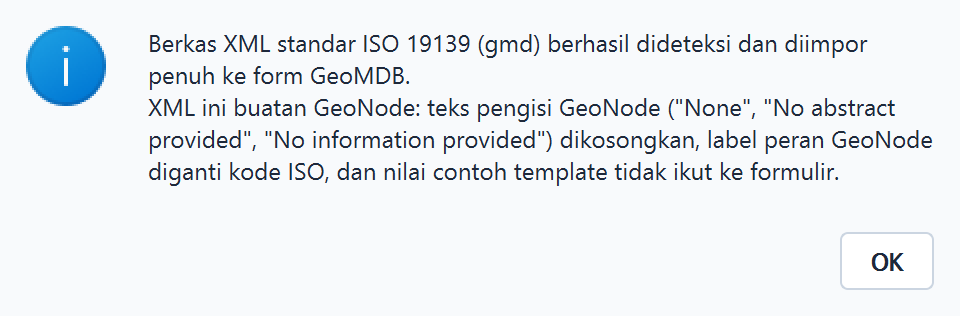
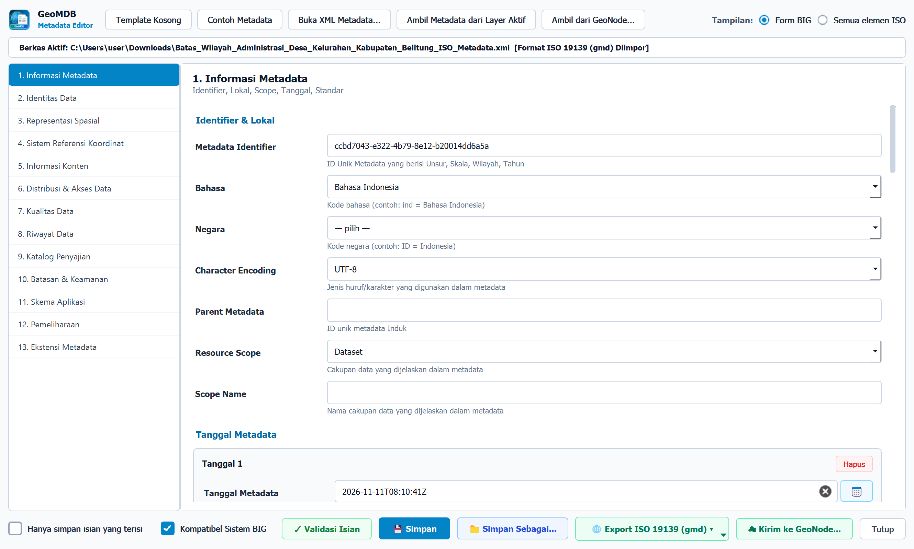

# Sesi 03 – Memulai metadata

**Tujuan:** memilih titik awal pengisian yang tepat sesuai kondisi data Anda.
**Waktu:** ±30 menit.

GeoMDB punya lima cara memulai, semuanya lewat tombol header:

| Kondisi Anda | Tombol | Sesi |
|---|---|---|
| Membuat metadata dari nol | **Template Kosong** | di bawah |
| Ingin melihat contoh isian lengkap | **Contoh Metadata** | di bawah |
| Sudah punya berkas XML metadata (GeoMDB, BIG, Palapa, unduhan GeoNode, ekspor ArcGIS) | **Buka XML Metadata…** | di bawah |
| Data vektor sudah terbuka di QGIS | **Ambil Metadata dari Layer Aktif** | di bawah |
| Dataset sudah ada di GeoNode dan Anda punya akunnya | **Ambil dari GeoNode…** | [Sesi 15](15-login-dan-ambil-dari-geonode.md) |

> Memuat sumber baru **mengganti** isi formulir. Simpan dulu pekerjaan yang sedang terbuka (sesi 12).

## A. Template Kosong

Klik **Template Kosong**. Formulir berisi struktur metadata standar BIG tanpa isian, dan baris status menampilkan
`Mode Aktif: Template Kosong (Standar BIG)`. Saat pertama kali disimpan, GeoMDB meminta lokasi berkas
(**Simpan Sebagai…**).

## B. Contoh Metadata

Klik **Contoh Metadata** untuk memuat metadata contoh yang terisi lengkap dan sesuai validasi sistem BIG. Pakai
untuk belajar bentuk isian tiap kolom. Isinya fiktif (mis. *Pusat Data Geospasial Contoh*), jadi **jangan dipakai
sebagai metadata data Anda**.

Contoh metadata **raster** tidak punya tombol sendiri. Buka berkas `contoh_raster.xml` di folder plugin dengan
**Buka XML Metadata…**. Folder plugin ada di
**Settings › User Profiles › Open Active Profile Folder** › `python/plugins/iso19115_metadata_editor/`.

## C. Buka XML Metadata…

1. Klik **Buka XML Metadata…**, pilih berkas `.xml`.
2. GeoMDB mengenali formatnya sendiri:

| Format berkas | Hasil |
|---|---|
| ISO 19115-3 (`mdb`) – hasil simpan GeoMDB atau sistem BIG | Dimuat apa adanya |
| ISO 19139 (`gmd`) – Palapa, pycsw, ekspor ArcGIS (*Export ISO 19139*), dll. | Diubah otomatis ke struktur ISO 19115-3; baris status diberi tanda `[Format ISO 19139 (gmd) Diimpor]` |
| ISO 19139 buatan GeoNode (menu **Download › ISO Metadata**) | Seperti di atas, plus dibersihkan: teks pengisi GeoNode (`None`, `No abstract provided`, `No information provided`) dikosongkan dan label peran GeoNode diganti kode ISO |

Hasil impor XML unduhan GeoNode, misalnya Tahap 1:

**Kondisi:**

- **XML dari GeoNode**: judul, abstrak, cakupan wilayah, CRS, format, dan tautan layanan GeoNode ikut terisi.
  `Metadata Identifier` berisi UUID dataset GeoNode; biarkan apa adanya bila metadata akan dikirim balik ke dataset
  yang sama.
- **XML ArcGIS**: pakai hasil *Export Metadata* dengan *translator* ISO 19139 (mis. `ARCGIS2ISO19139`) atau ekspor
  ISO 19139 dari ArcGIS Pro. Berkas `.shp.xml` bawaan ArcGIS dan format FGDC **tidak** terbaca utuh.
- **XML respons CSW** (berisi pembungkus `GetRecordByIdResponse`) tidak terbaca utuh. Ambil XML lewat menu
  **Download › ISO Metadata** di GeoNode atau gunakan **Ambil dari GeoNode…**.
- **XML yang tidak valid** (rusak, bukan XML): muncul pesan *Gagal membaca XML*; periksa berkasnya di editor teks.

## D. Ambil Metadata dari Layer Aktif

Mengisi formulir otomatis dari layer **vektor** yang dipilih di panel **Layers** QGIS.

1. Buka data vektor di QGIS (Shapefile, GeoPackage, GeoJSON, dll.), klik layernya di panel **Layers**.
2. Di GeoMDB klik **Ambil Metadata dari Layer Aktif**. Bila formulir masih kosong, GeoMDB memuat Template Kosong
   lebih dulu.
3. Jendela **Metadata Terisi Otomatis dari Layer** menampilkan semua isian yang terisi per tahapan, plus daftar
   atribut layer. Nilai lama pada kolom tersebut **ditimpa**.

Yang diisi otomatis:

| Tahap | Kolom | Sumber di QGIS |
|---|---|---|
| 1 | Metadata Identifier, Parent Metadata, Bahasa, Character Encoding | **Layer Properties › Metadata** dan encoding sumber data |
| 1 | Resource Scope = Dataset; Tanggal Metadata = sekarang (Creation) | Otomatis |
| 2 | Judul Data (bila kosong: nama layer), Abstrak, tanggal pembuatan/publikasi/revisi | **Layer Properties › Metadata** |
| 2 | Batas Bujur Barat/Timur, Lintang Selatan/Utara | Extent layer, otomatis diubah ke derajat WGS 84 |
| 2 | Periode Awal/Akhir | Extent waktu di metadata layer, atau **Temporal** layer yang aktif |
| 2 | Topic Category, kelompok Kata Kunci | Kategori & kata kunci di metadata layer |
| 2 | Format, Kontak | Jenis penyimpanan data; kontak di metadata layer (juga disimpan ke Kontak Tersimpan) |
| 3 | Tipe Representasi = Vector, Topologi = Geometry Only, Tipe Objek Geometri, Jumlah Objek Geometri | Jenis geometri & jumlah fitur |
| 4 | Nama, Kode, Code Space, Tipe Sistem Referensi | CRS layer (mis. `EPSG` / `4326`) |
| 5 | Katalog unsur aktif, satu tipe unsur bernama layer | Nama layer |
| 6 | Format distribusi, Transfer Size (MB), Akses Daring | Jenis berkas, ukuran berkas, tautan di metadata layer |
| 8 | Deskripsi Lineage | **History** di metadata layer |
| 10 | Batasan Penggunaan, Batasan Hukum Lainnya | *Fees*, *Constraints*, *Licenses*, *Rights* di metadata layer |

> **Tips:** semakin lengkap **Layer Properties › Metadata** di QGIS, semakin banyak kolom GeoMDB yang terisi.
> Instansi yang sudah rutin mengisi metadata layer QGIS bisa langsung memanfaatkannya.

**Kondisi:**

| Kondisi | Yang terjadi / dilakukan |
|---|---|
| Tidak ada layer terpilih | Pesan *Pilih sebuah layer di panel Layers terlebih dahulu* |
| Layer raster (GeoTIFF, DEM, citra) | Pesan bahwa pengambilan otomatis baru mendukung layer vektor. Isi tahap 3–5 secara manual ([sesi 07](07-tahap-3-5-representasi-crs-konten.md)) |
| Layer CRS proyeksi (mis. UTM) | Cakupan wilayah tetap ditulis dalam derajat WGS 84; Tahap 4 berisi CRS asli layer |
| Layer sementara (*memory/scratch*) | Format dan ukuran berkas tidak terisi |
| Formulir tertaut ke dataset GeoNode | GeoMDB bertanya dulu, karena isian dari layer akan ikut terkirim ke dataset itu ([sesi 16](16-kirim-ke-geonode.md)) |
| Ingin menggabungkan dengan XML yang sudah ada | Buka XML dulu (C), lalu **Ambil Metadata dari Layer Aktif**: hanya kolom yang tercantum di atas yang ditimpa |

## Latihan

1. Buka data vektor latihan di QGIS, isi **Layer Properties › Metadata** (judul, abstrak, satu kata kunci).
2. Di GeoMDB: **Template Kosong** → **Ambil Metadata dari Layer Aktif**. Catat kolom yang terisi.
3. Simpan dengan **Simpan Sebagai…** (sesi 12), lalu buka lagi berkas itu dengan **Buka XML Metadata…**.

**Lanjut ke:** [Sesi 04 – Kontak tersimpan](04-kontak-tersimpan.md)
