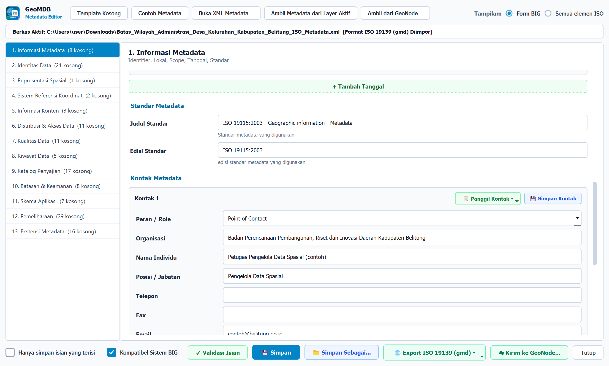

# Sesi 04 – Kontak tersimpan

**Tujuan:** mengisi kontak sekali, lalu memakainya ulang di semua bagian kontak dan semua metadata berikutnya.
**Waktu:** ±20 menit.

Metadata memuat kontak di banyak tempat: kontak metadata (Tahap 1), pihak bertanggung jawab dan kontak data
(Tahap 2), distributor (Tahap 6), katalog penyajian (Tahap 9), dan pemeliharaan (Tahap 12). Fitur **Kontak
Tersimpan** mencegah Anda mengetik ulang data yang sama.

## Isian satu blok kontak

| Kolom | Contoh | Catatan |
|---|---|---|
| **Peran / Role** | Point of Contact | Lihat tabel peran di bawah |
| **Organisasi** | Badan Perencanaan Pembangunan, Riset dan Inovasi Daerah Kabupaten Belitung | Nama resmi instansi, tanpa singkatan saja |
| **Nama Individu** | Petugas Pengelola Data Spasial | Boleh nama jabatan bila petugas sering berganti |
| **Posisi / Jabatan** | Pengelola Data Spasial | |
| **Telepon**, **Fax** | +62 719 21xxx | Format internasional disarankan |
| **Email** | data@instansi.go.id | Utamakan email dinas/fungsional, bukan email pribadi |
| **Alamat**, **Kota**, **Provinsi**, **Kode Pos**, **Negara** | Jl. …, Tanjung Pandan, Kepulauan Bangka Belitung, 334xx, Indonesia | |
| **Jam Layanan** | Senin–Jumat 08.00–16.00 WIB | Opsional |
| **Instruksi Kontak** | Permintaan data melalui surat resmi atau email | Opsional |

## Menyimpan kontak

1. Isi satu blok kontak sampai lengkap.
2. Klik **💾 Simpan Kontak** di kanan atas blok itu.
3. Isi **Nama profil kontak** (bawaan: nama organisasi), klik **OK**.

Kontak yang terbaca dari metadata layer QGIS (sesi 03 D) juga otomatis tersimpan.

## Memanggil kontak

1. Di blok kontak mana pun, klik **📋 Panggil Kontak ▾**.
2. Pilih nama profil. Semua kolom blok itu terisi.
3. Sesuaikan **Peran / Role** dengan bagian tempat kontak itu dipakai (mis. **Distributor** di Tahap 6).

Butuh lebih dari satu kontak di satu bagian? Klik **+ Tambah Kontak** di bawah blok terakhir, lalu panggil profil
lain.

## Mengelola kontak

**📋 Panggil Kontak ▾ › ⚙ Kelola Kontak Tersimpan…** membuka daftar profil. Pilih profil lalu klik
**Hapus Kontak Terpilih** untuk menghapusnya. Untuk mengubah isi profil, panggil profil itu ke blok kontak, ubah
isiannya, lalu simpan lagi dengan nama yang sama.

Plugin sudah membawa dua profil contoh: *Pusat Data Geospasial Contoh* dan *Badan Informasi Geospasial (BIG)*.
Hapus atau sesuaikan bila tidak dipakai.

> Profil kontak disimpan di berkas `contacts_presets.json` dalam folder plugin. Cadangkan berkas ini sebelum
> memperbarui plugin ([sesi 01](01-instalasi.md#memperbarui-ke-versi-baru)). Berkas yang sama bisa disalin ke
> komputer rekan agar satu instansi memakai kontak yang seragam.

## Memilih peran (Role)

| Peran | Kapan dipakai | Contoh di pemerintah daerah |
|---|---|---|
| **Point of Contact** | Pihak yang dihubungi untuk pertanyaan tentang data/metadata | Petugas pengelola data di OPD produsen |
| **Originator** | Pembuat/penyusun data | OPD yang memproduksi data |
| **Owner** | Pemilik data | Instansi pemilik data |
| **Custodian** | Penanggung jawab pemeliharaan dan keberlangsungan data | Unit yang memelihara data |
| **Resource Provider** | Penyedia data untuk pengguna | Unit layanan data |
| **Distributor** | Pihak yang mendistribusikan data | Walidata / Diskominfo pengelola geoportal |
| **Publisher** | Penerbit data | Pengelola geoportal |
| **Processor** | Pengolah data (di tahap proses) | Tim pengolah data |
| **Author** | Penulis metadata atau dokumen | Penyusun metadata |
| **User** | Pengguna data (di tab **Penggunaan**) | OPD pengguna |
| **Principal Investigator**, **Sponsor**, **Funder** | Kegiatan riset/proyek | Ketua tim kegiatan, pemberi dana |

Pembagian peran Produsen Data dan Walidata di atas adalah saran umum. Ikuti ketentuan Simpul Jaringan di instansi
Anda bila sudah ada.

## Latihan

1. Isi kontak instansi Anda di Tahap 1 **Kontak Metadata**, lalu **💾 Simpan Kontak**.
2. Panggil profil itu di Tahap 2 tab **Kontak** dan di Tahap 6 **Kontak Distributor**; ubah perannya menjadi
   **Distributor** di Tahap 6.

**Lanjut ke:** [Sesi 05 – Tahap 1 Informasi Metadata](05-tahap-1-informasi-metadata.md)
