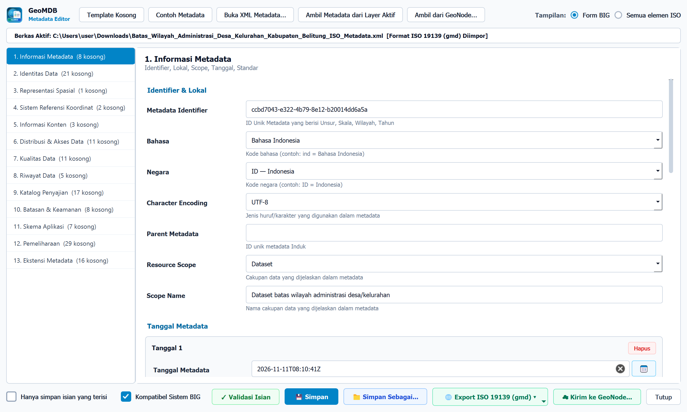

# Sesi 05 – Tahap 1: Informasi Metadata

**Tujuan:** mengisi keterangan tentang *metadata itu sendiri*: identitas, bahasa, tanggal, standar, dan siapa
penanggung jawabnya.
**Waktu:** ±20 menit.

## Isian

### Identifier & Lokal

| Kolom | Isi | Contoh |
|---|---|---|
| **Metadata Identifier** | ID unik metadata. Saran BIG: gabungan unsur, skala, wilayah, tahun. Nilai ini juga menjadi awal nama berkas saat menyimpan/mengekspor | `ADMINISTRASI_AR_DESA_10K_1902_2023` |
| **Bahasa** | Bahasa isi metadata | Bahasa Indonesia (`ind`) |
| **Negara** | Negara | ID — Indonesia |
| **Character Encoding** | Pengodean karakter | UTF-8 |
| **Parent Metadata** | ID metadata induk, bila data ini bagian dari seri | Kosongkan bila tidak ada |
| **Resource Scope** | Jenis sumber daya yang dijelaskan | Dataset |
| **Scope Name** | Nama cakupan | Dataset batas wilayah administrasi desa/kelurahan |

### Tanggal Metadata

Satu blok **Tanggal** berisi **Tanggal Metadata** dan **Tipe Tanggal**. Tambah blok dengan **+ Tambah Tanggal**.

| Situasi | Tipe Tanggal |
|---|---|
| Metadata pertama kali dibuat | Creation |
| Metadata diperbaiki/diperbarui | Revision (tambahkan blok baru, blok Creation tetap) |
| Metadata diterbitkan di katalog | Publication |

Format tanggal-waktu: `2026-11-11T10:00:00`, atau klik 📅.

### Standar Metadata

| Kolom | Contoh |
|---|---|
| **Judul Standar** | `ISO 19115-3 Geographic information - Metadata - XML schema implementation` |
| **Edisi Standar** | `2016` |

XML yang diimpor dari GeoNode biasanya membawa nilai `ISO 19115:2003`. Biarkan saja bila metadata akan dikirim
balik ke GeoNode, atau ganti dengan nilai di atas bila berkas akan menjadi arsip ISO 19115-3.

### Kontak Metadata

Siapa yang bertanggung jawab atas **metadata** (bukan atas datanya). Biasanya pengelola data di instansi produsen
atau Walidata. Gunakan **📋 Panggil Kontak ▾** ([sesi 04](04-kontak-tersimpan.md)), peran **Point of Contact**.

## Kondisi khusus

| Kondisi | Yang dilakukan |
|---|---|
| Metadata hasil impor dari GeoNode | **Metadata Identifier** berisi UUID dataset GeoNode (mis. `ccbd7043-e322-…`). Biarkan bila metadata akan dikirim balik ke dataset yang sama |
| Data bagian dari seri (mis. peta per kecamatan, citra per tahun) | Isi **Parent Metadata** dengan ID metadata seri; untuk metadata seri itu sendiri pilih **Resource Scope** = Series |
| Metadata untuk layanan (WMS/WFS saja, tanpa berkas data) | **Resource Scope** = Service |
| Data non-spasial (tabel) | **Resource Scope** = Non Geographic Dataset |
| Revisi metadata lama | Tambah blok tanggal **Revision** bertanggal hari ini; jangan ubah tanggal Creation |
| Satu instansi membuat banyak metadata | Sepakati pola **Metadata Identifier** yang seragam (unsur_skala_kodewilayah_tahun) agar mudah dicari |

**Lanjut ke:** [Sesi 06 – Tahap 2 Identitas Data](06-tahap-2-identitas-data.md)
