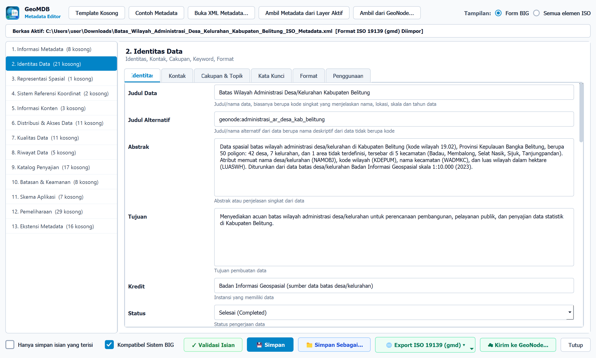
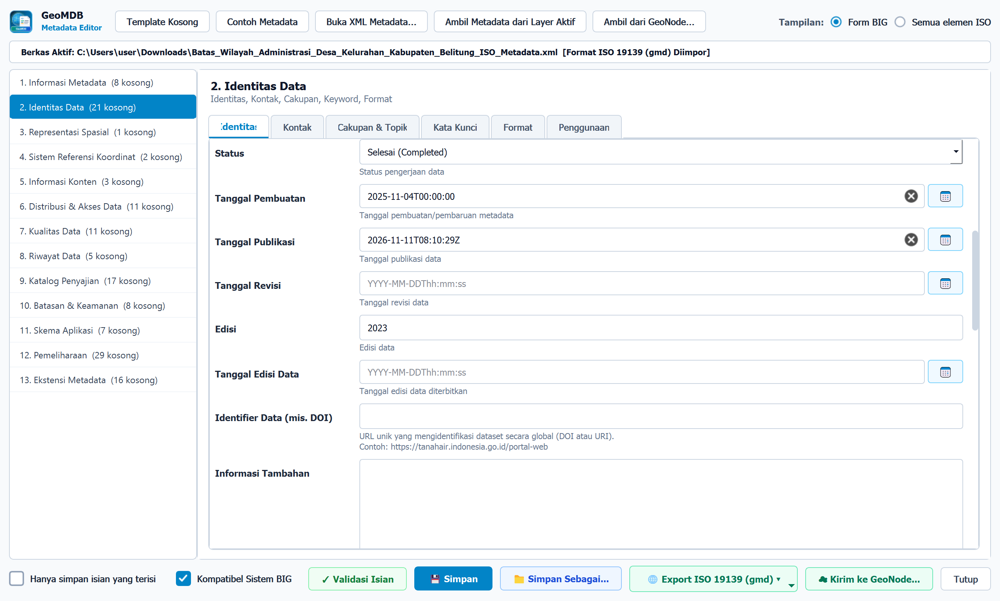
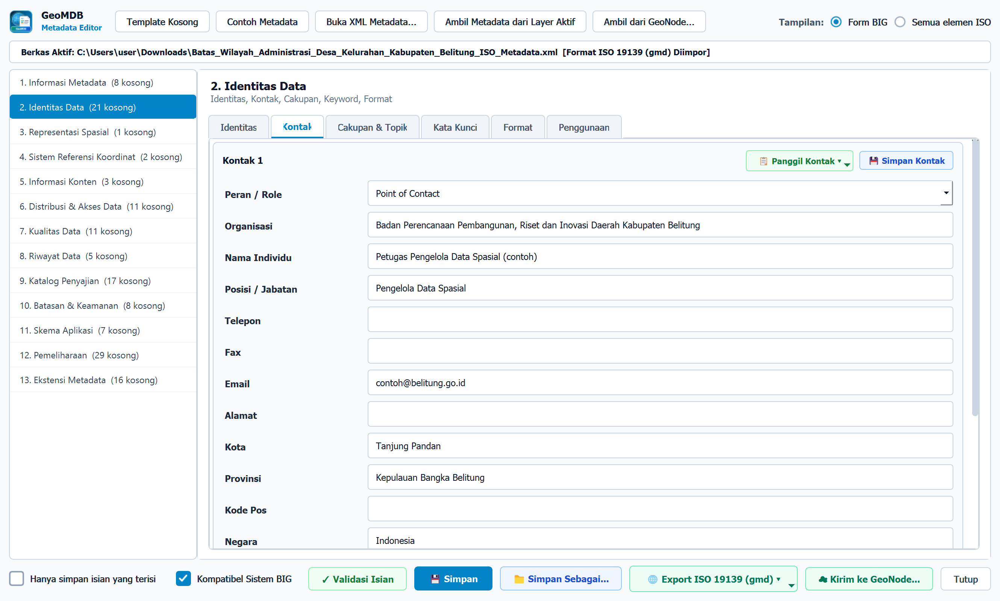
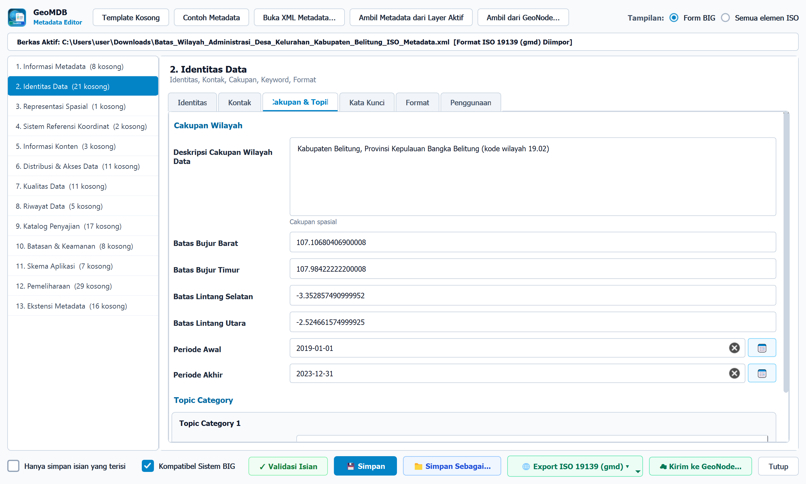
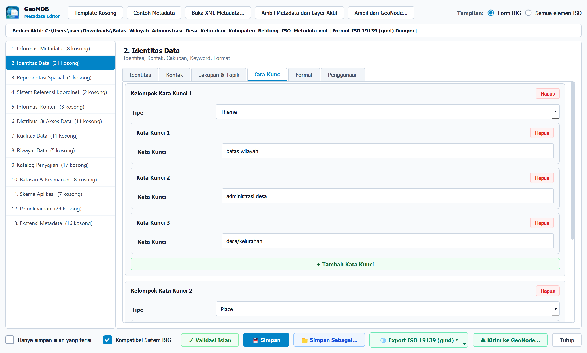
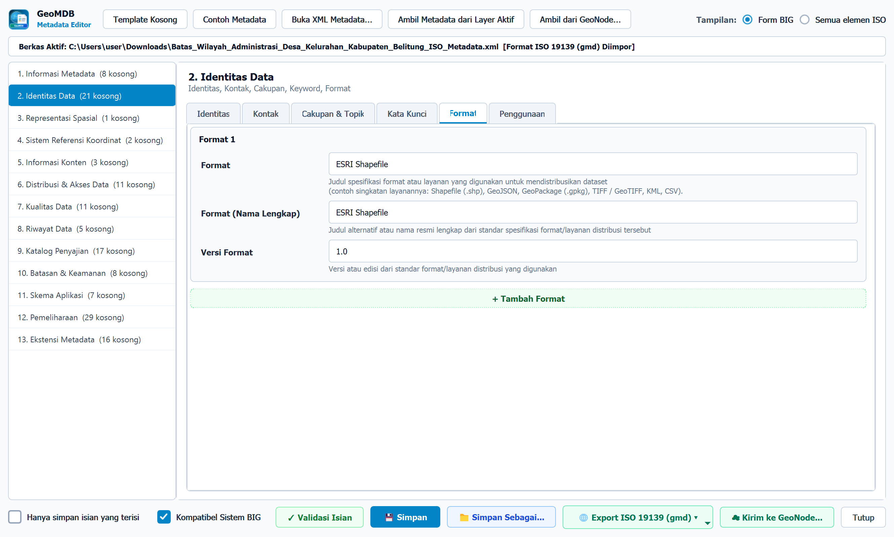

# Sesi 06 – Tahap 2: Identitas Data

**Tujuan:** menjelaskan *datanya*: apa, siapa pembuatnya, di mana, kapan, tentang apa, dan dalam format apa.
Tahap ini paling banyak dibaca pengguna katalog, jadi isi dengan teliti.
**Waktu:** ±45 menit.

Tahap 2 terbagi menjadi enam tab: **Identitas**, **Kontak**, **Cakupan & Topik**, **Kata Kunci**, **Format**, dan
**Penggunaan**.

## Tab Identitas

| Kolom | Isi | Contoh |
|---|---|---|
| **Judul Data** | Nama data yang jelas: unsur + wilayah (+ tahun/skala bila perlu). Hindari singkatan dan nama berkas | Batas Wilayah Administrasi Desa/Kelurahan Kabupaten Belitung |
| **Judul Alternatif** | Nama lain, nama layer, atau singkatan | `ADMINISTRASI_AR_DESA_KAB_BELITUNG` |
| **Abstrak** | Ringkasan isi data, lihat panduan di bawah | lihat di bawah |
| **Tujuan** | Untuk apa data dibuat | Menyediakan acuan batas wilayah administrasi desa/kelurahan untuk perencanaan pembangunan, pelayanan publik, dan penyajian data statistik di Kabupaten Belitung. |
| **Kredit** | Pihak yang berjasa/sumber yang perlu disebut | Badan Informasi Geospasial (sumber data batas desa/kelurahan) |
| **Status** | Tahap penyelesaian data | Selesai (Completed) |
| **Tanggal Pembuatan / Publikasi / Revisi** | Tanggal data dibuat, diterbitkan, direvisi | `2025-11-04` |
| **Edisi**, **Tanggal Edisi Data** | Versi/edisi data | `2023` |
| **Identifier Data (mis. DOI)** | Pengenal data global, bila ada | `https://doi.org/…` |
| **Informasi Tambahan** | Keterangan lain yang tidak masuk kolom lain | Opsional |
| **Bentuk Penyajian** | Bentuk data | Map Digital (`mapDigital`) untuk data vektor/peta digital |
| **Online Resource URL / Name / Protocol / Function** | Tautan ke halaman informasi data (bukan tautan unduhan; tautan unduhan di Tahap 6) | Halaman katalog data |
| **Pihak Bertanggung Jawab atas Sitasi** | Pembuat/pemilik data | Kontak OPD produsen, peran **Originator** |

### Menulis abstrak yang baik

Abstrak menjawab **apa – di mana – kapan – dari mana – isinya apa**, dalam 3–6 kalimat. Contoh:

> Data spasial batas wilayah administrasi desa/kelurahan di Kabupaten Belitung (kode wilayah 19.02), Provinsi
> Kepulauan Bangka Belitung, berupa 50 poligon: 42 desa, 7 kelurahan, dan 1 area tidak terdefinisi, tersebar di
> 5 kecamatan (Badau, Membalong, Selat Nasik, Sijuk, Tanjungpandan). Atribut memuat nama desa/kelurahan (NAMOBJ),
> kode wilayah (KDEPUM), nama kecamatan (WADMKC), dan luas wilayah dalam hektare (LUASWH). Diturunkan dari data
> batas desa/kelurahan Badan Informasi Geospasial skala 1:10.000 (2023).

Hindari abstrak yang hanya mengulang judul, misalnya "Data batas desa Kabupaten Belitung."

## Tab Kontak

Kontak yang bisa dihubungi tentang **data** (peran **Point of Contact**). Gunakan **📋 Panggil Kontak ▾**
([sesi 04](04-kontak-tersimpan.md)).

## Tab Cakupan & Topik

| Kolom | Isi | Contoh |
|---|---|---|
| **Deskripsi Cakupan Wilayah Data** | Nama wilayah | Kabupaten Belitung, Provinsi Kepulauan Bangka Belitung (kode wilayah 19.02) |
| **Batas Bujur Barat / Timur** | Bujur dalam derajat desimal WGS 84; Barat < Timur | `107.1068` / `107.9842` |
| **Batas Lintang Selatan / Utara** | Lintang dalam derajat desimal; lintang selatan bernilai negatif; Selatan < Utara | `-3.3529` / `-2.5247` |
| **Periode Awal / Akhir** | Rentang waktu yang diwakili data (bukan tanggal pembuatan) | `2019-01-01` / `2023-12-31` |
| **Topic Category** | Kategori topik ISO; boleh lebih dari satu (**+ Tambah Topic Category**) | Boundaries |

Batas wilayah paling mudah diisi otomatis dengan **Ambil Metadata dari Layer Aktif** ([sesi 03](03-memulai-metadata.md)).
Indonesia berada di sekitar bujur 95°–141° BT dan lintang 6° LU sampai 11° LS. Nilai di luar rentang itu
menandakan salah isi, misalnya koordinat UTM dalam meter yang tertulis di kolom derajat.

Pilihan **Topic Category** yang sering dipakai:

| Data | Topic Category |
|---|---|
| Batas administrasi | Boundaries |
| Jalan, rel, pelabuhan | Transportation |
| Penggunaan/tutupan lahan, citra, peta dasar | Imagery Base Maps Earth Cover |
| DEM, kontur, batimetri | Elevation |
| Sungai, danau, DAS | Inland Waters |
| Tata ruang, bidang tanah | Planning Cadastre |
| Kependudukan, sosial, pendidikan, kesehatan | Society / Health |
| Rawan bencana | Disaster, **ditambah** Geoscientific Information atau Environment |
| Utilitas, jaringan listrik/air/telekomunikasi | Utilities Communication |

**Disaster** dan **Extra Terrestrial** hanya ada di ISO 19115-3. Saat ekspor ISO 19139 (Palapa, CSW, GeoNode)
keduanya tidak ikut, sehingga tambahkan selalu satu kategori lain yang ada di ISO 19139.

## Tab Kata Kunci

Kata kunci dikelompokkan per **Tipe**. Tambah kelompok dengan **+ Tambah Kelompok Kata Kunci**, tambah kata kunci
dalam kelompok dengan **+ Tambah Kata Kunci**.

| Tipe | Isi | Contoh |
|---|---|---|
| **Theme** | Tema/isi data | batas wilayah, administrasi desa, desa/kelurahan |
| **Place** | Nama tempat | Kabupaten Belitung, Kepulauan Bangka Belitung |
| **Temporal** | Periode | 2023 |
| **Stratum** | Lapisan/tingkat | (jarang dipakai) |

Satu kata kunci per kotak. Jangan menggabungkan beberapa kata kunci dengan koma dalam satu kotak.

## Tab Format

Format data **asli** yang dijelaskan metadata. Format distribusi (yang diberikan ke pengguna) diisi di Tahap 6.

| Data | Format | Format (Nama Lengkap) | Versi Format |
|---|---|---|---|
| Shapefile | ESRI Shapefile | ESRI Shapefile | 1.0 |
| GeoPackage | GPKG | GeoPackage | 1.3 |
| GeoJSON | GeoJSON | GeoJSON (RFC 7946) | 1.0 |
| GeoTIFF | GeoTIFF | GeoTIFF | 1.1 |

## Tab Penggunaan

Siapa yang memakai data dan untuk apa (opsional, berguna untuk evaluasi pemanfaatan data).

| Kolom | Contoh |
|---|---|
| **Penggunaan Spesifik** | Perencanaan pembangunan dan penyajian peta wilayah administrasi desa/kelurahan |
| **Peran / Role** | User |
| **Organisasi Pengguna** | Perangkat Daerah Kabupaten Belitung |
| **Posisi/jabatan pengguna** | Opsional |

## Kondisi khusus

| Kondisi | Yang dilakukan |
|---|---|
| Data deret waktu (mis. 2021, 2023, 2024 dalam satu dataset) | **Periode Awal** = tahun data tertua, **Periode Akhir** = terbaru; tambahkan kata kunci tipe **Temporal**. Lihat [studi kasus E](17-studi-kasus.md#e-data-deret-waktu) |
| Data masih dikerjakan | **Status** = Dalam Proses (Under Development) |
| Data lama yang diganti versi baru | **Status** = Tidak Berlaku (Superseded) pada metadata lama |
| Data punya DOI | Isi **Identifier Data (mis. DOI)** dengan URL DOI lengkap; nilainya ikut diekspor ke ISO 19139 |
| Data meliputi beberapa kabupaten | Satu cakupan wilayah yang melingkupi semuanya; sebutkan semua nama wilayah di **Deskripsi Cakupan Wilayah Data** dan kata kunci **Place** |
| Data non-spasial (tabel) | Kosongkan batas wilayah bila memang tidak ada; isi deskripsi cakupan wilayah |
| Data citra/raster | **Topic Category** Imagery Base Maps Earth Cover atau Elevation; format GeoTIFF |

**Lanjut ke:** [Sesi 07 – Tahap 3–5](07-tahap-3-5-representasi-crs-konten.md)
