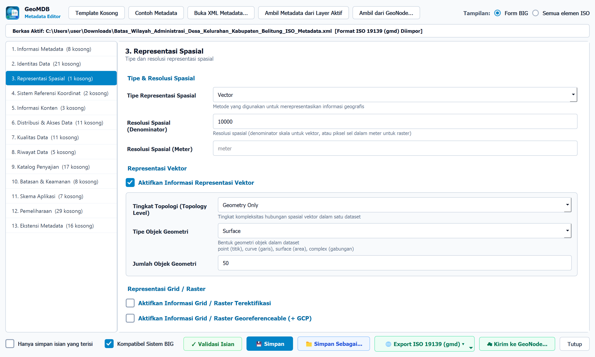
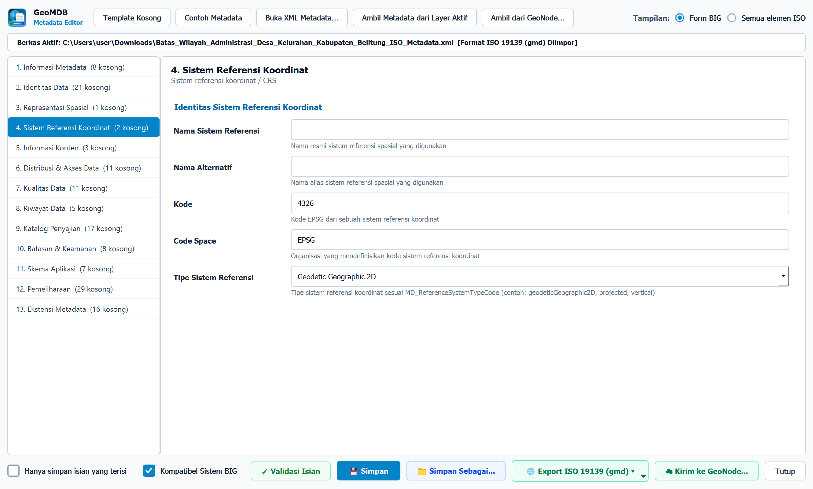
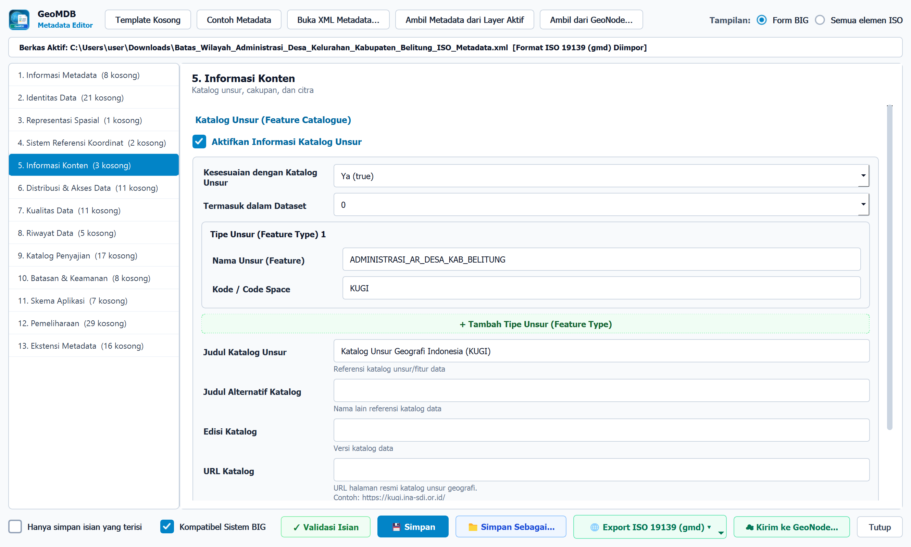

# Sesi 07 – Tahap 3–5: Representasi Spasial, Sistem Referensi Koordinat & Informasi Konten

**Tujuan:** menjelaskan bentuk teknis data, untuk data **vektor** maupun **raster**.
**Waktu:** ±40 menit.

Untuk data vektor, sebagian besar isian tahap ini terisi otomatis lewat **Ambil Metadata dari Layer Aktif**. Untuk
data raster, isi secara manual dengan nilai dari QGIS.

## Tahap 3 – Representasi Spasial

### Tipe & Resolusi Spasial

| Kolom | Vektor | Raster |
|---|---|---|
| **Tipe Representasi Spasial** | Vector | Grid |
| **Resolusi Spasial (Denominator)** | Penyebut skala, mis. `10000` untuk 1:10.000 | Boleh kosong |
| **Resolusi Spasial (Meter)** | Kosong | Ukuran piksel di lapangan, mis. `8` |

Pilihan lain: **Text Table** (tabel), **TIN** (jaringan segitiga), **Stereo Model**, **Video**.

### Data vektor – centang **Aktifkan Informasi Representasi Vektor**

| Kolom | Isi |
|---|---|
| **Tingkat Topologi (Topology Level)** | Geometry Only (paling umum). Planar Graph / Full Planar Graph bila data dijamin topologis (tanpa celah/tumpang tindih, bersambung di simpul) |
| **Tipe Objek Geometri** | Surface (poligon), Curve (garis), Point (titik), Composite/Complex (campuran) |
| **Jumlah Objek Geometri** | Jumlah fitur, mis. `50` |

Data dengan beberapa jenis geometri (mis. GeoPackage berisi titik dan poligon): tambahkan informasi per jenis
lewat mode **Semua elemen ISO**, atau buat metadata terpisah per layer.

### Data raster – centang salah satu blok grid

| Blok | Kapan dipakai |
|---|---|
| **Aktifkan Informasi Grid / Raster Terektifikasi** | Raster yang sudah tersusun pada grid peta: DEM, mosaik ortofoto, citra ortho, hasil klasifikasi (GeoTIFF umumnya di sini) |
| **Aktifkan Informasi Grid / Raster Georeferenceable (+ GCP)** | Citra mentah yang belum direktifikasi tetapi punya titik kontrol (GCP) atau parameter orientasi |

Isian utama raster terektifikasi:

| Kolom | Isi | Contoh (DEM 8 m) |
|---|---|---|
| **Jumlah Dimensi Spasial** | Biasanya 2 | `2` |
| **Geometri Sel** | `area` bila nilai piksel mewakili luasan (citra, tutupan lahan); `point` bila nilai di titik pusat (grid DEM) | `point` |
| **Dimensi** (2 blok) | **Nama Dimensi**: `row` dan `column`; **Ukuran Sel (jumlah)**: jumlah baris/kolom piksel; **Resolusi (meter)**: ukuran piksel | row 4500 / 8; column 6000 / 8 |
| **Parameter Transformasi Tersedia** | `true` bila parameter georeferensi tersedia | `true` |
| **Check Point Tersedia**, **Deskripsi Check Point** | Ada titik uji akurasi? | `false` |
| **Corner 1/2 Lat/Lon** | Koordinat dua sudut diagonal (lintang dulu, lalu bujur) | |
| **Centre Lat/Lon** | Koordinat titik tengah | |
| **Orientasi Piksel (Point in Pixel)** | Posisi koordinat terhadap piksel, mis. `center` atau `upperLeft` | `center` |

**Mengambil nilainya dari QGIS:** klik kanan layer raster › **Properties › Information**. Bagian *Dimensions*
memuat lebar (X), tinggi (Y), dan jumlah band. Ada juga *Pixel Size*, *Extent*, CRS, dan tipe data. Alternatif:
**Raster › Miscellaneous › Raster Information** (gdalinfo).

## Tahap 4 – Sistem Referensi Koordinat

| Kolom | Isi | Contoh |
|---|---|---|
| **Nama Sistem Referensi** | Otoritas kode | `EPSG` |
| **Nama Alternatif** | Nama lengkap otoritas | European Petroleum Survey Group |
| **Kode** | Nomor EPSG | `4326` |
| **Code Space** | Ruang kode | `EPSG` |
| **Tipe Sistem Referensi** | Jenis CRS | Geodetic Geographic 2D (derajat) atau Projected (meter) |

Contoh kode EPSG yang sering dipakai di Indonesia:

| CRS | Kode | Tipe |
|---|---|---|
| WGS 84 geografis | 4326 | Geodetic Geographic 2D |
| WGS 84 / UTM zona 46S … 54S | 32746 … 32754 (mis. Belitung zona 48S = `32748`) | Projected |
| WGS 84 / Pseudo-Mercator (peta web) | 3857 | Projected |

Lihat kode CRS layer di QGIS: **Layer Properties › Information › CRS**, atau di pojok kanan bawah jendela QGIS
untuk CRS proyek.

## Tahap 5 – Informasi Konten

### Data vektor – Katalog Unsur

Centang **Aktifkan Informasi Katalog Unsur**.

| Kolom | Isi | Contoh |
|---|---|---|
| **Kesesuaian dengan Katalog Unsur** | Ya bila struktur data mengikuti katalog unsur baku | Ya (true) |
| **Termasuk dalam Dataset** | Apakah katalog unsur disertakan bersama data | Tidak (false) |
| **Tipe Unsur (Feature Type)** | **Nama Unsur** dan **Kode / Code Space** | `ADMINISTRASI_AR_DESA_KAB_BELITUNG` / `KUGI` |
| **Judul Katalog Unsur** | Nama katalog | Katalog Unsur Geografi Indonesia (KUGI) |
| **Judul Alternatif**, **Edisi**, **URL Katalog** | Edisi dan tautan katalog | URL halaman KUGI |

Satu dataset berisi beberapa unsur (mis. jalan dan jembatan): tambah dengan **+ Tambah Tipe Unsur (Feature Type)**.

### Data raster – Deskripsi Cakupan & Citra

| Blok | Kapan |
|---|---|
| **Aktifkan Deskripsi Cakupan (Coverage Description)** | Raster berisi nilai ukur atau kelas: DEM, suhu, curah hujan, tutupan lahan |
| **Aktifkan Deskripsi Citra (Image Description)** | Citra satelit/foto udara. Berisi semua isian cakupan, plus sudut matahari, tutupan awan, kalibrasi, dll. |

Isian penting:

| Kolom | Contoh DEM | Contoh citra satelit |
|---|---|---|
| **Deskripsi Atribut** | Ketinggian permukaan tanah (meter) | Reflektansi permukaan |
| **Grup Atribut › Content Type** | `physicalMeasurement` | `image` |
| **Band** (satu blok per band) | **Deskripsi Band**: Elevasi; **Min/Max Value**: `-5` / `510`; **Bits Per Value**: `32` | Band merah: **Bound Min/Max (nm)** `650` / `680` |
| **Cloud Cover (%)** | — | `5` |
| **Illumination Elevation / Azimuth Angle (°)** | — | dari berkas metadata citra |

Nilai min/max band bisa dilihat di **Layer Properties › Information** (bila statistik sudah dihitung) atau
**Symbology** (*Min / max value settings*).

## Kondisi khusus

| Kondisi | Yang dilakukan |
|---|---|
| Data vektor dari **Ambil Metadata dari Layer Aktif** | Tahap 3–5 sudah terisi; tinggal lengkapi **Resolusi Spasial (Denominator)**, **Judul Katalog Unsur**, dan **Code Space** |
| Data raster | Isi manual seperti di atas. Bandingkan dengan contoh `contoh_raster.xml` di folder plugin ([sesi 03](03-memulai-metadata.md#b-contoh-metadata)) |
| Raster multi-band (citra) | Satu blok **Band** per band; urutkan sesuai urutan band berkas |
| Raster yang akan dikirim ke sistem BIG | Biarkan **Kompatibel Sistem BIG** tercentang saat menyimpan versi untuk BIG. Untuk berkas kerja yang akan dibuka dan disunting ulang di GeoMDB, simpan juga salinan dengan opsi itu **tidak** dicentang (ISO 19115-3 standar), karena struktur raster gaya BIG tidak selalu terbaca utuh saat dibuka ulang ([sesi 12](12-validasi-dan-simpan.md)) |
| Bagian ISO 19115-2 (GCP, band dengan rentang panjang gelombang, informasi pengolahan) | Tersimpan di berkas ISO 19115-3, tetapi **tidak** ikut ekspor ISO 19139; GeoMDB mencantumkannya di catatan kesesuaian ([sesi 13](13-ekspor-xml.md)) |
| Data skala tidak diketahui | Kosongkan denominator; jelaskan sumber dan ketelitian di Tahap 8 |

**Lanjut ke:** [Sesi 08 – Tahap 6 Distribusi & Akses Data](08-tahap-6-distribusi.md)
