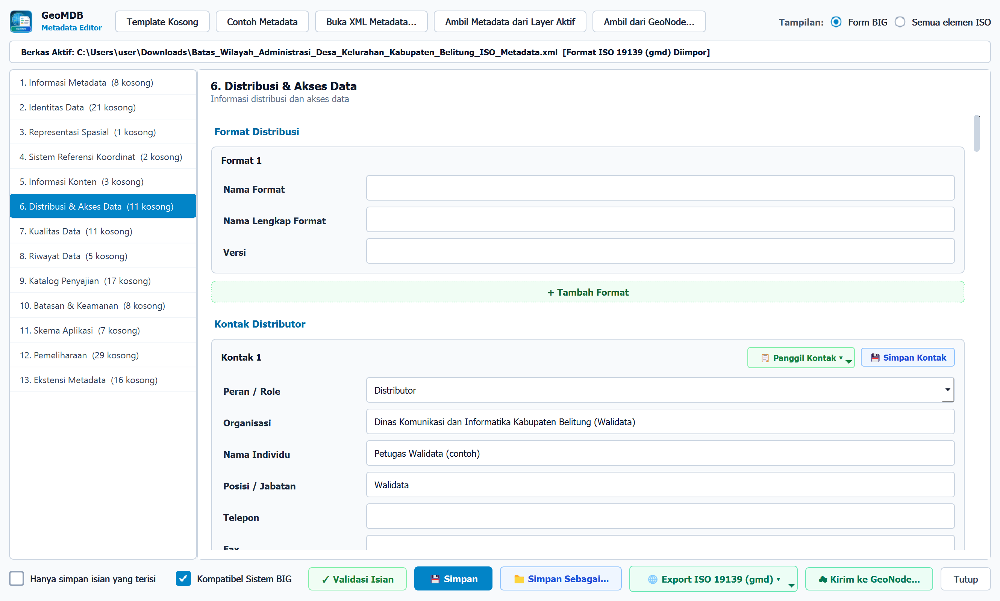
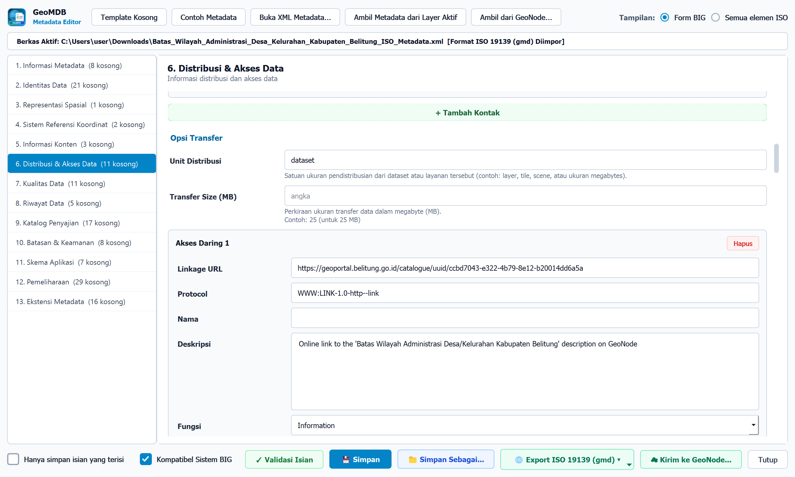

# Sesi 08 – Tahap 6: Distribusi & Akses Data

**Tujuan:** memberi tahu pengguna **bagaimana memperoleh data**: format yang diberikan, siapa distributornya, dan
tautan layanan atau unduhannya.
**Waktu:** ±30 menit.

## Format Distribusi

Format data yang **diberikan kepada pengguna** (bisa berbeda dengan format asli di Tahap 2). Tambah dengan
**+ Tambah Format** bila tersedia beberapa format.

| Kolom | Contoh |
|---|---|
| **Nama Format** | ESRI Shapefile |
| **Nama Lengkap Format** | ESRI Shapefile |
| **Versi** | 1.0 |

## Kontak Distributor

Pihak yang menyalurkan data. Di Simpul Jaringan daerah, biasanya Walidata (mis. Diskominfo pengelola geoportal).
Panggil kontak tersimpan, lalu pilih peran **Distributor** ([sesi 04](04-kontak-tersimpan.md)).

## Opsi Transfer

| Kolom | Isi | Contoh |
|---|---|---|
| **Unit Distribusi** | Satuan pembagian data | `dataset`, `layer`, `tile`, atau `scene` |
| **Transfer Size (MB)** | Ukuran unduhan dalam megabyte (angka saja) | `25` |
| **Akses Daring** | Satu blok per tautan, lihat di bawah | |

### Akses Daring

| Kolom | Isi |
|---|---|
| **Linkage URL** | Alamat lengkap (diawali `https://`) |
| **Protocol** | Jenis tautan, lihat tabel berikut |
| **Nama** | Untuk WMS/WFS: **nama layer** di server (mis. `geonode:administrasi_ar_desa_kab_belitung`); untuk tautan lain: judul singkat |
| **Deskripsi** | Penjelasan singkat |
| **Fungsi** | Download, Information, Order, Search, Browse Graphic, dll. |

Protokol yang umum dipakai:

| Jenis tautan | Protocol | Contoh Linkage URL | Fungsi |
|---|---|---|---|
| Layanan peta WMS | `OGC:WMS` | `https://geoportal.contoh.go.id/geoserver/ows` | Information |
| Layanan fitur WFS | `OGC:WFS` | `https://geoportal.contoh.go.id/geoserver/ows` | Download |
| Layanan coverage WCS (raster) | `OGC:WCS` | `https://geoportal.contoh.go.id/geoserver/ows` | Download |
| Unduhan berkas langsung | `WWW:DOWNLOAD-1.0-http--download` | `https://…/batas_desa.zip` | Download |
| Halaman informasi/katalog | `WWW:LINK-1.0-http--link` | `https://geoportal.contoh.go.id/catalogue/#/dataset/11` | Information |
| Layanan ArcGIS REST | `ESRI:ArcGIS:MapServer` atau `ESRI:ArcGIS:FeatureServer` | `https://…/MapServer` | Information |

Pada layanan WMS/WFS, **Linkage URL** cukup alamat layanan tanpa parameter `?service=…`. Nama layer ditulis di
kolom **Nama**.

ISO 19139 (dipakai Palapa, CSW, dan GeoNode) hanya mengenal fungsi **Download**, **Information**, **Offline
Access**, **Order**, dan **Search**. Fungsi lain (**Browsing**, **File Access**, **Browse Graphic**, dll.) berasal
dari ISO 19115-3; tetap diekspor, tetapi dicatat sebagai nilai di luar ISO 19139 ([sesi 13](13-ekspor-xml.md)).

## Kondisi khusus

| Kondisi | Yang dilakukan |
|---|---|
| Data belum dipublikasikan di geoportal | Isi format dan kontak distributor saja; tambahkan tautan setelah data terbit |
| Data hanya bisa diminta (tidak diunduh bebas) | Satu Akses Daring berfungsi **Order** ke halaman/formulir permintaan, dan isi **Instruksi Kontak** distributor (mis. "Permintaan melalui surat resmi") |
| Metadata diimpor dari GeoNode | Tautan WMS/WFS/unduhan dan gambar mini GeoNode sudah ikut, jumlahnya bisa belasan. Hapus yang tidak perlu dengan **Hapus**, atau biarkan |
| Data dikirim ke GeoNode dengan mode preserve | Tautan layanan GeoNode disisipkan otomatis saat kirim; tautan ganda (URL dan protokol sama) dibuang ([sesi 16](16-kirim-ke-geonode.md)) |
| Data tersedia dalam beberapa format | Satu blok **Format** per format, dan satu Akses Daring unduhan per berkas |
| Data rahasia/terbatas | Jangan cantumkan tautan unduhan publik; isi batasan akses di Tahap 10 ([sesi 11](11-tahap-9-13-lainnya.md)) |

**Lanjut ke:** [Sesi 09 – Tahap 7 Kualitas Data](09-tahap-7-kualitas-data.md)
