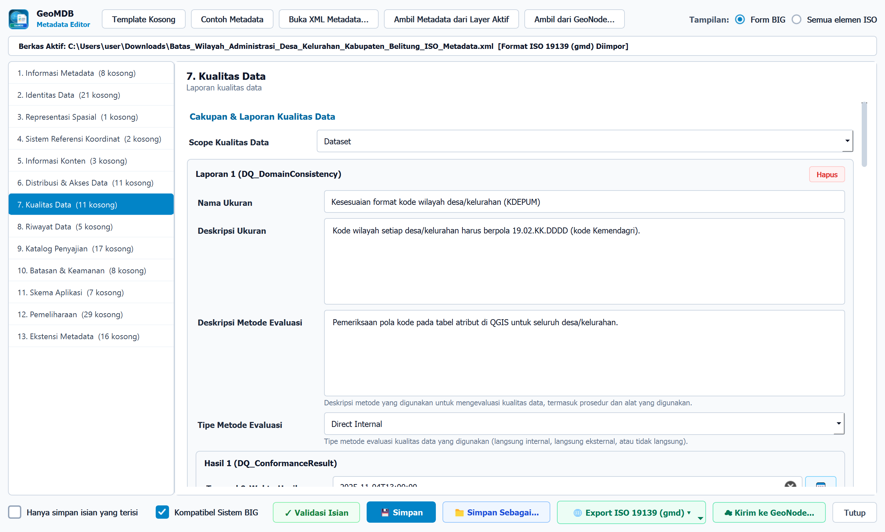
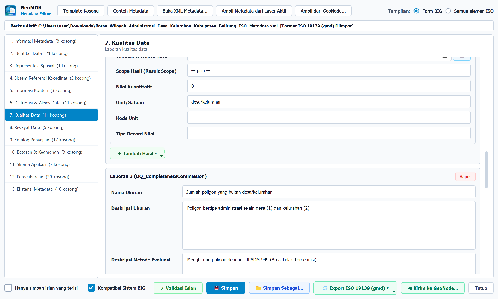
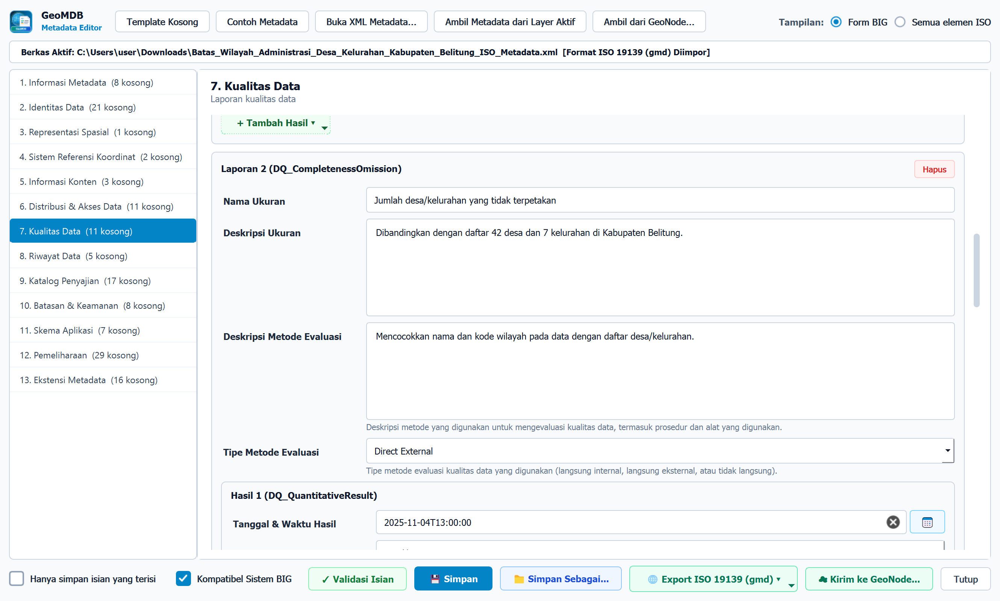

# Sesi 09 – Tahap 7: Kualitas Data

**Tujuan:** melaporkan hasil pemeriksaan mutu data agar pengguna tahu seberapa layak data dipakai.
**Waktu:** ±45 menit.

Satu **Laporan** = satu aspek mutu yang diperiksa, lengkap dengan cara memeriksa dan **Hasil**-nya. Isi laporan
hanya untuk pemeriksaan yang benar-benar dilakukan.

## Langkah

1. **Scope Kualitas Data**: cakupan yang dinilai, biasanya **Dataset**.
2. Isi **Laporan 1** yang sudah ada, atau tambah laporan dengan **+ Tambah Laporan ▾** lalu pilih jenisnya.
3. Di setiap laporan isi:

   | Kolom | Isi |
   |---|---|
   | **Nama Ukuran** | Apa yang diukur |
   | **Deskripsi Ukuran** | Penjelasan ukuran/kriteria |
   | **Deskripsi Metode Evaluasi** | Bagaimana pemeriksaan dilakukan (alat, prosedur) |
   | **Tipe Metode Evaluasi** | **Direct Internal** (memeriksa data itu sendiri), **Direct External** (membandingkan dengan data/rujukan lain), **Indirect** (dari informasi lain, mis. riwayat produksi) |

4. Tambah hasil dengan **+ Tambah Hasil ▾** dan pilih jenis hasil (lihat di bawah).

## Jenis laporan

| Jenis (pilihan di menu) | Artinya | Contoh ukuran |
|---|---|---|
| **Completeness Omission** | Kekurangan: objek yang seharusnya ada tetapi tidak ada | Jumlah desa yang tidak terpetakan |
| **Completeness Commission** | Kelebihan: objek yang tidak seharusnya ada | Jumlah poligon yang bukan desa/kelurahan |
| **Conceptual Consistency** | Kesesuaian dengan aturan model data | Atribut wajib menurut KUGI terisi |
| **Domain Consistency** | Nilai atribut sesuai domain/format | Kode wilayah berpola `19.02.KK.DDDD` |
| **Format Consistency** | Struktur berkas sesuai format | Berkas terbaca tanpa galat |
| **Topological Consistency** | Kebenaran topologi | Jumlah pasangan poligon tumpang tindih |
| **Absolute External Positional Accuracy** | Ketelitian posisi terhadap posisi sebenarnya | RMSE atau CE90 terhadap titik uji (meter) |
| **Relative Internal Positional Accuracy** | Ketelitian posisi relatif antarobjek | Selisih jarak antarobjek |
| **Gridded Data Positional Accuracy** | Ketelitian posisi data raster | RMSE posisi piksel |
| **Thematic Classification Correctness** | Ketepatan klasifikasi | Akurasi keseluruhan klasifikasi tutupan lahan (%) |
| **Non Quantitative Attribute Accuracy** | Ketepatan atribut teks | Persentase nama desa yang benar |
| **Quantitative Attribute Accuracy** | Ketepatan atribut angka | Selisih luas terhadap data resmi |
| **Temporal Consistency**, **Temporal Validity**, **Accuracy of a Time Measurement** | Mutu aspek waktu | Tanggal data dalam rentang yang benar |

## Jenis hasil

| Jenis (menu **+ Tambah Hasil**) | Kapan | Isian utama |
|---|---|---|
| **Conformance Result** | Membandingkan dengan spesifikasi: lulus/tidak | **Judul Spesifikasi**, **Penjelasan Hasil**, **Pass** (`true`/`false`), **Tanggal & Waktu Hasil** |
| **Quantitative Result** | Hasilnya angka | **Nilai Kuantitatif**, **Unit/Satuan**, (**Kode Unit**, **Tipe Record Nilai** opsional), **Tanggal & Waktu Hasil** |
| **Descriptive Result** | Hasilnya uraian | **Pernyataan Deskriptif** |
| **Coverage Result** | Hasilnya berupa data/peta (mis. peta sebaran galat) | Tipe representasi, nama/path dan tipe berkas hasil |

> **Ekspor ISO 19139** hanya memuat hasil **Conformance** dan **Quantitative**. Hasil **Descriptive** dan
> **Coverage** tetap tersimpan di berkas ISO 19115-3, tetapi tidak ikut ekspor ISO 19139 dan dicatat di catatan
> kesesuaian. Bila metadata akan dipakai di Palapa/GeoNode, utamakan kedua jenis pertama.

## Contoh lengkap: empat laporan data batas desa

| # | Jenis | Nama ukuran | Metode | Hasil |
|---|---|---|---|---|
| 1 | Domain Consistency | Kesesuaian format kode wilayah desa/kelurahan (KDEPUM) | Direct Internal – pemeriksaan pola kode pada tabel atribut di QGIS | Conformance: spesifikasi "Pola kode wilayah administrasi Kemendagri (19.02.KK.DDDD)", penjelasan "49 dari 49 desa/kelurahan berkode sesuai pola", Pass = `true` |
| 2 | Completeness Omission | Jumlah desa/kelurahan yang tidak terpetakan | Direct External – mencocokkan nama dan kode dengan daftar 42 desa dan 7 kelurahan | Quantitative: `0` desa/kelurahan |
| 3 | Completeness Commission | Jumlah poligon yang bukan desa/kelurahan | Direct Internal – menghitung poligon dengan TIPADM 999 (area tidak terdefinisi) | Quantitative: `1` poligon |
| 4 | Topological Consistency | Jumlah pasangan poligon desa yang tumpang tindih | Direct Internal – pemeriksaan topologi di QGIS (luas irisan, elipsoid WGS84) | Quantitative: `0` pasangan |

Pemeriksaan semacam ini bisa dilakukan di QGIS, misalnya:

- **Topologi**: **Vector › Geometry Tools › Check Validity**, plugin *Topology Checker*, atau **Processing ›
  Overlap analysis**.
- **Kelengkapan & domain atribut**: **Select by Expression**, misalnya
  `NOT regexp_match("KDEPUM", '^19\\.02\\.\\d{2}\\.\\d{4}$')` untuk mencari kode yang salah pola.

## Kondisi khusus

| Kondisi | Yang dilakukan |
|---|---|
| Belum ada pemeriksaan mutu sama sekali | Jangan mengarang hasil. Jelaskan proses produksi di Tahap 8 (lineage); laporan kualitas bisa ditambahkan setelah pemeriksaan |
| Ketelitian posisi diuji dengan titik uji lapangan/GCP | **Absolute External Positional Accuracy**, metode Direct External, hasil Quantitative `RMSE` dalam `meter`; sebutkan jumlah titik uji di **Deskripsi Metode Evaluasi** |
| Data raster hasil klasifikasi | **Thematic Classification Correctness**, hasil Quantitative akurasi keseluruhan (%) dan/atau koefisien Kappa |
| Data mengikuti standar/KUGI dan lulus pemeriksaan | Conformance Result, Pass = `true`, **Judul Spesifikasi** = nama standar/pedoman |
| Pemeriksaan gagal sebagian | Conformance Pass = `false` dengan penjelasan, atau Quantitative berisi jumlah kesalahan. Laporan jujur lebih berguna daripada data tanpa laporan |
| Metadata dari GeoNode | XML buatan GeoNode biasanya tanpa laporan kualitas; tambahkan sendiri |

> **Di GeoNode:** halaman dataset menampilkan *Data Quality Statement*. Isinya bergantung pada server: GeoNode
> standar hanya membaca sebagian isi XML, sedangkan server yang sudah memasang
> [tambalan GeoMDB](https://github.com/hariHK1/geonode-tambal-preserve) menampilkan lineage dan ringkasan laporan
> kualitas ([sesi 14](14-unggah-lewat-web-geonode.md)).

**Lanjut ke:** [Sesi 10 – Tahap 8 Riwayat Data](10-tahap-8-riwayat-data.md)
