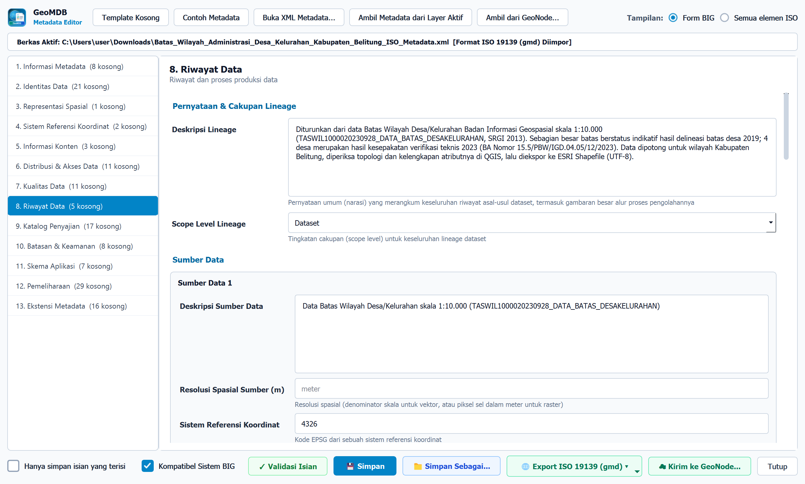
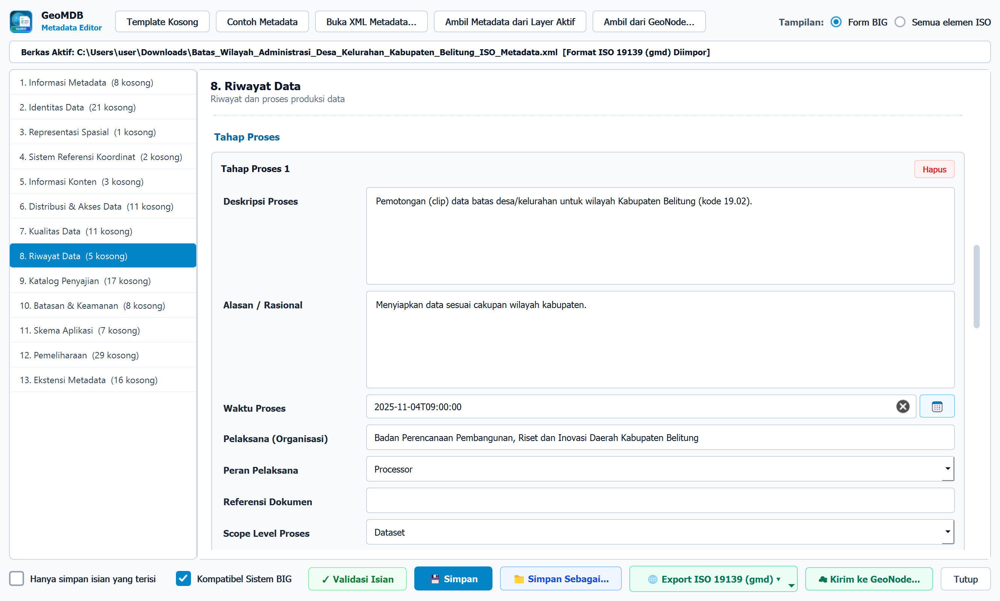

# Sesi 10 – Tahap 8: Riwayat Data

**Tujuan:** menceritakan **asal-usul data** (*lineage*): dari sumber apa, diolah bagaimana, kapan, dan oleh siapa.
**Waktu:** ±30 menit.

Tahap ini punya tiga bagian: pernyataan umum (**Deskripsi Lineage**), **Sumber Data**, dan **Tahap Proses**.

## Pernyataan & Cakupan Lineage

| Kolom | Isi |
|---|---|
| **Deskripsi Lineage** | Ringkasan riwayat data dalam satu paragraf |
| **Scope Level Lineage** | Biasanya **Dataset** |

Contoh **Deskripsi Lineage**:

> Diturunkan dari data Batas Wilayah Desa/Kelurahan Badan Informasi Geospasial skala 1:10.000
> (TASWIL1000020230928_DATA_BATAS_DESAKELURAHAN, SRGI 2013). Sebagian besar batas berstatus indikatif hasil
> delineasi batas desa 2019; 4 desa merupakan hasil kesepakatan verifikasi teknis 2023 (BA Nomor
> 15.5/PBW/IGD.04.05/12/2023). Data dipotong untuk wilayah Kabupaten Belitung, diperiksa topologi dan kelengkapan
> atributnya di QGIS, lalu diekspor ke ESRI Shapefile (UTF-8).

## Sumber Data

Satu blok per data sumber. Tambah dengan **+ Tambah Sumber Data**.

| Kolom | Contoh |
|---|---|
| **Deskripsi Sumber Data** | Data Batas Wilayah Desa/Kelurahan skala 1:10.000 (TASWIL1000020230928_DATA_BATAS_DESAKELURAHAN) |
| **Resolusi Spasial Sumber (m)** | Untuk sumber raster/citra, mis. `0.5` |
| **Sistem Referensi Koordinat** / **Code Space CRS** | `4326` / `EPSG` |
| **Judul Sitasi Sumber** | Data Batas Desa/Kelurahan — Badan Informasi Geospasial |
| **Tanggal Sitasi** / **Tipe Tgl Sitasi** | `2023-09-28` / Creation |
| **Judul Metadata Sumber** | Judul metadata data sumber, bila ada |
| **Scope Level Sumber** | Dataset |

## Tahap Proses

Satu blok per langkah pengolahan, **berurutan dari yang paling awal**. Tambah dengan **+ Tambah Tahap Proses**.

| Kolom | Isi | Contoh |
|---|---|---|
| **Deskripsi Proses** | Apa yang dilakukan | Pemotongan (clip) data batas desa/kelurahan untuk wilayah Kabupaten Belitung (kode 19.02). |
| **Alasan / Rasional** | Mengapa dilakukan | Menyiapkan data sesuai cakupan wilayah kabupaten. |
| **Waktu Proses** | Tanggal-waktu proses | `2025-11-04T09:00:00` |
| **Pelaksana (Organisasi)** | Siapa yang mengerjakan | Badan Perencanaan Pembangunan, Riset dan Inovasi Daerah Kabupaten Belitung |
| **Peran Pelaksana** | Biasanya **Processor** | Processor |
| **Referensi Dokumen** | Dokumen acuan (SOP, juknis, BA) | Opsional |
| **Scope Level Proses** | Dataset | Dataset |

Contoh tiga tahap proses data batas desa:

1. Pemotongan (clip) data untuk wilayah kabupaten — `2025-11-04T09:00:00`.
2. Pemeriksaan topologi dan kelengkapan atribut di QGIS — `2025-11-04T13:00:00`.
3. Ekspor ke ESRI Shapefile (UTF-8) dan penyusunan metadata ISO 19139 — `2026-11-11T10:00:00`.

Rincian pengolahan lanjutan (perangkat lunak, algoritma, parameter, laporan, keluaran proses) tersedia di mode
**Semua elemen ISO**. Bagian ini termasuk ISO 19115-2, sehingga tersimpan di berkas ISO 19115-3 tetapi tidak ikut
ekspor ISO 19139.

## Kondisi khusus

| Kondisi | Isi lineage & tahap proses |
|---|---|
| Data hasil survei lapangan (GPS/GNSS) | Sumber: "Survei lapangan GNSS tahun …"; tahap: survei, pengolahan data GNSS, digitasi/penyusunan atribut, pemeriksaan |
| Data digitasi dari citra | Sumber: citra (judul, tanggal akuisisi, **Resolusi Spasial Sumber (m)**); tahap: koreksi geometrik/orthorektifikasi, digitasi, uji akurasi |
| Data gabungan beberapa sumber | Satu blok **Sumber Data** per sumber; jelaskan cara penggabungan di tahap proses |
| Data turunan dari data instansi lain | Sebutkan instansi asal di **Judul Sitasi Sumber** dan **Kredit** (Tahap 2) |
| Konversi format/sistem koordinat saja | Satu tahap proses, mis. "Transformasi dari EPSG:32748 ke EPSG:4326" |
| Pemutakhiran data | **Tambahkan** tahap proses baru bertanggal pemutakhiran, jangan hapus tahap lama; perbarui Tahap 12 |
| Metadata dari GeoNode | XML buatan GeoNode sering berisi lineage `None`; GeoMDB mengosongkannya saat impor, lalu isi sendiri |

**Lanjut ke:** [Sesi 11 – Tahap 9–13](11-tahap-9-13-lainnya.md)
