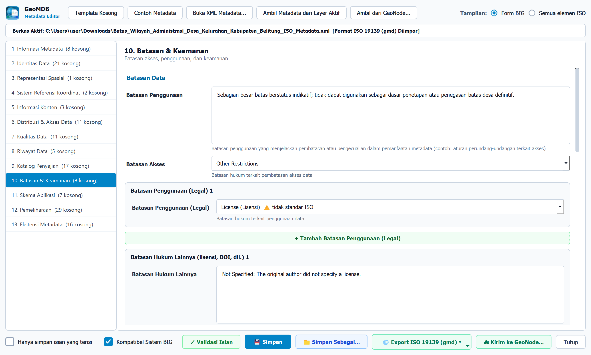
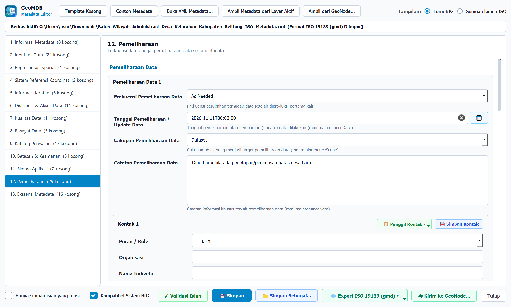

# Sesi 11 – Tahap 9–13: Katalog Penyajian, Batasan & Keamanan, Skema Aplikasi, Pemeliharaan, Ekstensi

**Tujuan:** melengkapi aturan penyajian, hak pakai, keamanan, dan rencana pemeliharaan data.
**Waktu:** ±40 menit.

Tahap 10 (**Batasan & Keamanan**) dan 12 (**Pemeliharaan**) sebaiknya selalu diisi. Tahap 9, 11, dan 13 opsional;
isi bila memang ada informasinya.

## Tahap 9 – Katalog Penyajian

Rujukan aturan simbol/penyajian peta yang dipakai.

| Kolom | Contoh |
|---|---|
| **Judul** | Pedoman simbol/penyajian yang diacu instansi |
| **Judul Alternatif** | Singkatan atau nomor dokumen |
| **URL** | Tautan dokumen, atau berkas gaya (SLD/QML) yang dibagikan |
| **Kontak** | Penyusun aturan penyajian |

## Tahap 10 – Batasan & Keamanan

### Batasan Data

| Kolom | Isi | Contoh |
|---|---|---|
| **Batasan Penggunaan** | Peringatan atau batas pemakaian, dalam kalimat | Sebagian besar batas berstatus indikatif; tidak dapat digunakan sebagai dasar penetapan atau penegasan batas desa definitif. |
| **Batasan Akses** | Kode pembatasan akses | Other Restrictions |
| **Batasan Penggunaan (Legal)** | Kode pembatasan pemakaian; boleh lebih dari satu (**+ Tambah Batasan Penggunaan (Legal)**) | Other Restrictions |
| **Batasan Hukum Lainnya (lisensi, DOI, dll.)** | Teks lisensi atau ketentuan; boleh lebih dari satu | Data terbuka untuk umum; wajib mencantumkan sumber: Pemerintah Kabupaten Belitung dan Badan Informasi Geospasial. |
| **Klasifikasi Keamanan** | Tingkat kerahasiaan | Unclassified |
| **User Note Keamanan**, **Sistem Klasifikasi**, **Handling Description** | Keterangan penanganan data terklasifikasi | Diisi bila data tidak terbuka |

Aturan ISO yang perlu diingat: bila **Batasan Akses** atau **Batasan Penggunaan (Legal)** bernilai
**Other Restrictions**, kolom **Batasan Hukum Lainnya** wajib berisi penjelasannya.

### Batasan Metadata

Sama seperti di atas, tetapi untuk **metadata**-nya (mis. metadata boleh dipublikasikan walau datanya terbatas).
Biasanya cukup **Klasifikasi Keamanan Metadata** = Unclassified.

### Contoh pengisian berdasarkan sifat data

| Sifat data | Batasan Akses | Batasan Hukum Lainnya | Klasifikasi Keamanan |
|---|---|---|---|
| Data terbuka | Other Restrictions | "Data terbuka; wajib mencantumkan sumber …" atau nama lisensi, mis. "Creative Commons Attribution 4.0 (CC BY 4.0)" | Unclassified |
| Data terbatas untuk instansi pemerintah | Restricted | "Hanya untuk keperluan internal pemerintah daerah; permintaan melalui surat resmi" | Restricted / For Official Use Only |
| Data dikecualikan (mis. infrastruktur vital) | Restricted | Dasar hukum pengecualian informasi | Confidential atau lebih tinggi; **jangan unggah ke portal publik** |
| Data berhak cipta pihak lain | Copyright | Pemegang hak dan syarat pemakaian | Unclassified |

Pilihan bertanda **⚠ tidak standar ISO** (mis. **License (Lisensi)**) berasal dari formulir BIG. Pilihan itu
boleh dipakai, tetapi katalog ISO murni bisa tidak mengenalinya ([sesi 02](02-mengenal-editor.md)).

## Tahap 11 – Skema Aplikasi

Opsional. Diisi bila data mengikuti model data/skema tertentu (mis. skema KUGI, model UML instansi).

| Kolom | Contoh |
|---|---|
| **Nama Schema** | Nama skema/model data |
| **Bahasa Schema** | `UML`, `XML Schema` |
| **Bahasa Constraint** | `OCL` (bila ada) |
| **Schema ASCII**, **Graphics URL/Name** | Isi skema atau tautan diagramnya |

## Tahap 12 – Pemeliharaan

### Pemeliharaan Data (bisa lebih dari satu blok)

| Kolom | Contoh |
|---|---|
| **Frekuensi Pemeliharaan Data** | As Needed (sesuai kebutuhan), Annually (tahunan), Monthly, Continual, Not Planned |
| **Tanggal Pemeliharaan / Update Data** | Tanggal pemutakhiran terakhir/berikutnya, mis. `2026-11-11T00:00:00` |
| **Cakupan Pemeliharaan Data** | Dataset |
| **Catatan Pemeliharaan Data** | Diperbarui bila ada penetapan/penegasan batas desa baru. |
| **Kontak** | Unit yang memelihara data, peran **Custodian** |

### Pemeliharaan Metadata

Isian yang sama untuk **metadata**-nya, mis. Frekuensi As Needed dan catatan "Metadata diperbarui bersamaan
dengan pembaruan data."

| Sifat data | Frekuensi |
|---|---|
| Data yang diperbarui setiap tahun (mis. statistik, RTRW tahunan) | Annually |
| Data yang diperbarui bila ada perubahan (batas wilayah, jaringan jalan) | As Needed |
| Data selesai dan tidak akan diubah (arsip, citra tahun tertentu) | Not Planned |
| Data sensor/real time | Continual |

## Tahap 13 – Ekstensi Metadata

Opsional, untuk pengguna mahir:

- **Sumber Daring Ekstensi** dan **Elemen Ekstensi**: bila instansi menambahkan elemen di luar ISO (profil
  metadata sendiri); jelaskan nama, definisi, kewajiban, tipe data, dan aturannya.
- **Aktifkan Informasi Akuisisi**: untuk citra/data penginderaan jauh: platform (satelit/pesawat), sponsor
  platform, dan rencana akuisisi.

## Kondisi khusus

| Kondisi | Yang dilakukan |
|---|---|
| Lisensi belum diputuskan | **Batasan Hukum Lainnya**: "Ketentuan penggunaan mengikuti kebijakan [instansi]; hubungi kontak data"; perbarui setelah lisensi ditetapkan |
| GeoNode menampilkan lisensi | Lisensi yang dipilih di GeoNode ikut terbawa ke **Batasan Hukum Lainnya** saat metadata diambil dari GeoNode |
| Data citra dari penyedia komersial | **Batasan Penggunaan (Legal)** = Licence/Copyright; sebutkan pemegang lisensi dan batas pemakaian |
| Data sudah tidak dipelihara | Frekuensi Not Planned; **Status** (Tahap 2) Historical Archive atau Obsolete |

**Lanjut ke:** [Sesi 12 – Validasi & simpan](12-validasi-dan-simpan.md)
