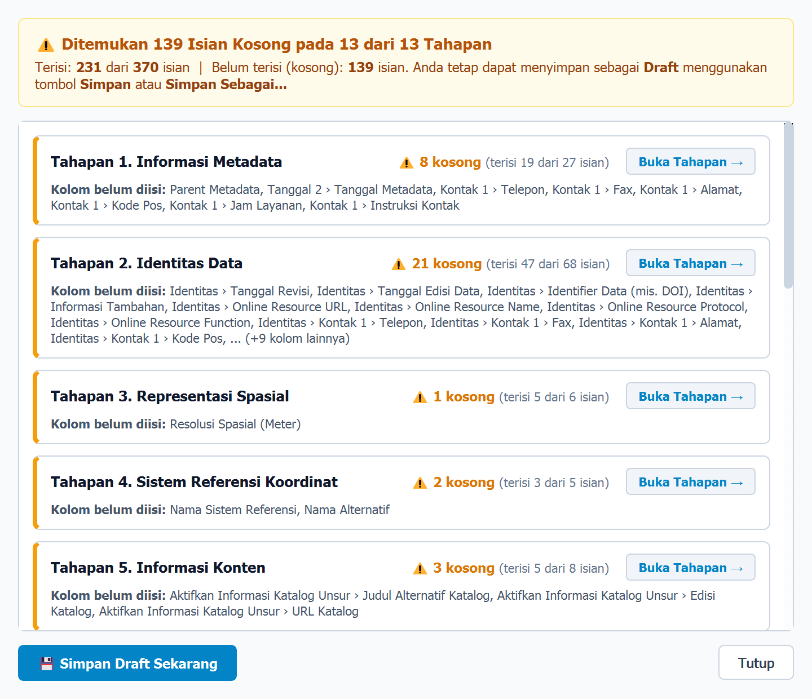

# Sesi 12 – Validasi & simpan

**Tujuan:** memeriksa kelengkapan isian, menyimpan draf maupun versi final, dan memahami catatan kesesuaian
standar.
**Waktu:** ±25 menit.

## Validasi Isian

Klik **✓ Validasi Isian** kapan saja. Jendela **Hasil Validasi Kelengkapan Isian Metadata** menampilkan:

- ringkasan jumlah isian terisi dan kosong;
- satu kartu per tahapan dengan jumlah kosong dan daftar **Kolom belum diisi**;
- tombol **Buka Tahapan →** untuk langsung ke tahapan itu;
- tombol **💾 Simpan Draft Sekarang**.

Setelah validasi, daftar tahapan di kiri diberi tanda `(n kosong)` atau `✓`.

Validasi **tidak menghalangi penyimpanan**. Kolom kosong belum tentu salah, karena banyak kolom opsional atau tidak
relevan untuk data Anda (mis. kolom raster pada data vektor). Fokuskan pada isian inti berikut:

| Tahap | Isian inti yang sebaiknya selalu ada |
|---|---|
| 1 | Metadata Identifier, Bahasa, Tanggal Metadata, Kontak Metadata |
| 2 | Judul Data, Abstrak, Tanggal Pembuatan, Status, Kontak, Batas wilayah, Topic Category, Kata Kunci |
| 3–4 | Tipe Representasi Spasial, skala/resolusi, Kode CRS |
| 6 | Kontak Distributor, minimal satu Akses Daring bila data sudah terbit |
| 8 | Deskripsi Lineage |
| 10 | Batasan Akses/Penggunaan, Klasifikasi Keamanan |
| 12 | Frekuensi Pemeliharaan Data |

## Simpan dan Simpan Sebagai

| Tombol | Pintasan | Fungsi |
|---|---|---|
| **💾 Simpan** | `Ctrl+S` | Menyimpan ke berkas aktif. Bila belum ada berkas (Template Kosong/Contoh), membuka **Simpan Sebagai** |
| **📁 Simpan Sebagai…** | `Ctrl+Shift+S` | Menyimpan ke berkas baru, lalu berkas itu menjadi berkas aktif |

- Berkas disimpan dalam format **ISO 19115-3** (`mdb`), format kerja GeoMDB yang memuat semua isian.
- Nama bawaan: `<Metadata Identifier>_<yyyymmdd>.xml`, mis. `ADMINISTRASI_AR_DESA_10K_1902_2023_20261111.xml`.
- Setelah tersimpan, baris status menampilkan `Berkas Aktif: … — [Tersimpan 10:15:02 | Status: Draft (139 isian belum
  lengkap)]` atau `Status: Lengkap`.
- Berkas bisa dibuka lagi kapan saja dengan **Buka XML Metadata…**.

> Berkas ISO 19115-3 dari **Simpan** adalah **arsip lengkap** metadata Anda. Simpan berkas ini walaupun yang
> diunggah ke portal adalah hasil ekspor ISO 19139, karena ekspor ISO 19139 tidak memuat beberapa bagian
> (sesi 13).

## Dua opsi di baris bawah

| Opsi | Bawaan | Bila dicentang | Bila tidak dicentang |
|---|---|---|---|
| **Hanya simpan isian yang terisi** | Tidak dicentang | Elemen kosong dibuang dari XML. Berkas lebih ringkas dan bisa lolos validasi skema (XSD) | Seluruh struktur, termasuk kolom kosong, ikut tersimpan. Cocok untuk **draf** yang akan dilanjutkan, tetapi berkasnya belum lolos validasi XSD |
| **Kompatibel Sistem BIG** | Dicentang | Struktur raster, band, dan tahap proses disesuaikan agar terbaca penuh saat diimpor atau divalidasi di sistem BIG | Berkas ISO 19115-3 **standar murni** (valid terhadap XSD dan aturan Schematron ISO) |

Pilih kombinasinya sesuai kebutuhan:

| Kondisi | Hanya simpan isian yang terisi | Kompatibel Sistem BIG |
|---|---|---|
| Masih dikerjakan (draf) | ☐ | ☑ (bawaan) |
| Versi final untuk sistem BIG | ☑ | ☑ |
| Versi final untuk katalog ISO 19115-3 lain atau validasi XSD | ☑ | ☐ |
| Data raster yang akan dibuka dan disunting lagi di GeoMDB | ☐ | ☐ (struktur raster gaya BIG tidak selalu terbaca utuh saat dibuka ulang) |

Kedua opsi **tidak memengaruhi ekspor ISO 19139** (sesi 13).

## Catatan Kesesuaian Standar

Setelah menyimpan, GeoMDB bisa menampilkan jendela **Catatan Kesesuaian Standar — Simpan ISO 19115-3**. Isinya
pemberitahuan, bukan galat:

| Kelompok catatan | Artinya | Tindakan |
|---|---|---|
| Struktur tidak standar ISO 19115-3 (opsi "Kompatibel Sistem BIG" dicentang) | Bagian yang disesuaikan untuk sistem BIG | Wajar bila tujuannya sistem BIG |
| Nilai daftar kode di luar ISO 19115-3 | Pilihan bertanda ⚠ tidak standar ISO | Ganti dengan pilihan standar bila tujuannya katalog ISO |
| Berkas draf | Jumlah isian kosong yang ikut tersimpan | Centang **Hanya simpan isian yang terisi** untuk versi final |

Jendela hanya muncul bila isi catatannya **berubah** sejak simpan sebelumnya. Bila sama, cukup muncul pesan
singkat di bilah pesan QGIS, sehingga Anda tidak terganggu saat sering menekan `Ctrl+S`.

## Kondisi khusus

| Kondisi | Yang dilakukan |
|---|---|
| Lupa menyimpan lalu menutup jendela | Isian hilang. Biasakan `Ctrl+S` setelah setiap tahapan |
| Ingin beberapa versi berkas | Pakai **Simpan Sebagai…** dengan nama berbeda (tanggal di nama berkas membantu) |
| Menyimpan ke folder bersama/jaringan | Bisa; pastikan dua orang tidak menyunting berkas yang sama bersamaan |
| Berkas aktif hasil impor ISO 19139 | **Simpan** menulis ISO 19115-3 ke berkas yang sama sehingga berkas ISO 19139 aslinya tertimpa. Gunakan **Simpan Sebagai…** bila ingin mempertahankan berkas asli |

**Lanjut ke:** [Sesi 13 – Ekspor XML](13-ekspor-xml.md)
