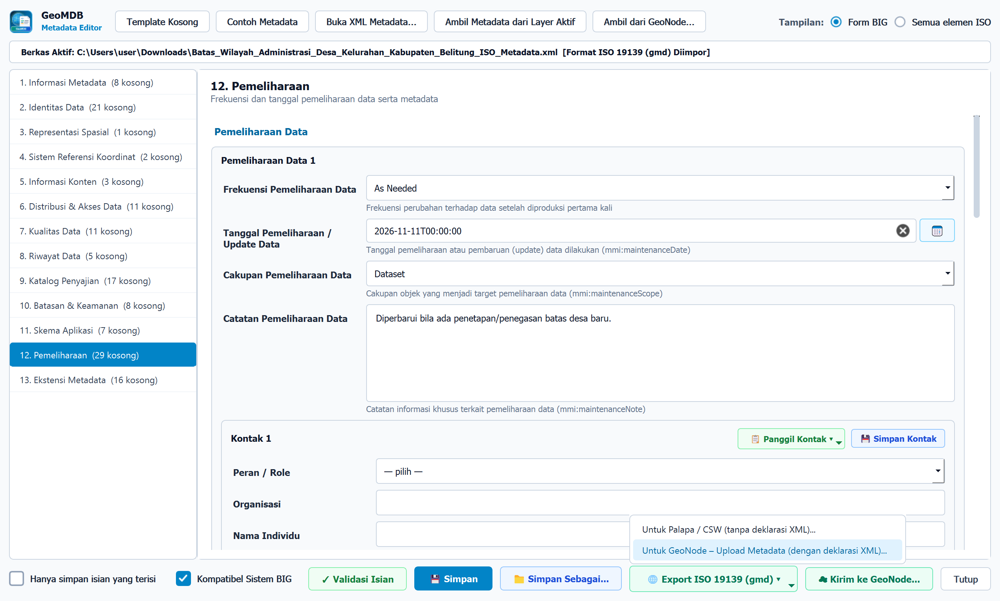
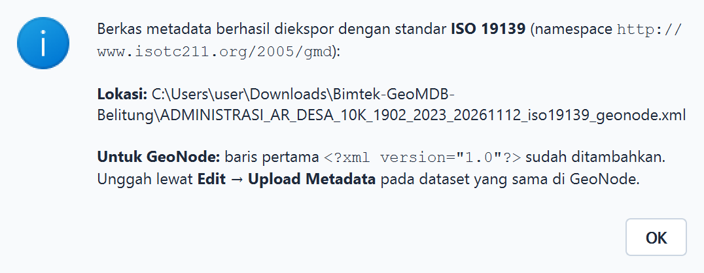

# Sesi 13 – Ekspor XML

**Tujuan:** menghasilkan berkas XML yang tepat untuk tiap tujuan: Palapa/CSW, GeoNode, atau arsip ISO 19115-3.
**Waktu:** ±20 menit.

## Format yang dihasilkan GeoMDB

| Tujuan | Tombol | Format | Nama berkas bawaan |
|---|---|---|---|
| Arsip lengkap, sistem BIG | **💾 Simpan** / **📁 Simpan Sebagai…** ([sesi 12](12-validasi-dan-simpan.md)) | ISO 19115-3 (`mdb`) | `<ID>_<yyyymmdd>.xml` |
| Geoportal Palapa, pycsw, CSW-T, katalog ISO 19139 lain | **🌐 Export ISO 19139 (gmd) ▾ › Untuk Palapa / CSW (tanpa deklarasi XML)…** | ISO 19139 (`gmd`) tanpa baris `<?xml …?>` | `<ID>_<yyyymmdd>_iso19139.xml` |
| GeoNode – menu **Edit › Upload Metadata** | **🌐 Export ISO 19139 (gmd) ▾ › Untuk GeoNode – Upload Metadata (dengan deklarasi XML)…** | ISO 19139 (`gmd`), baris pertama `<?xml version="1.0"?>` | `<ID>_<yyyymmdd>_iso19139_geonode.xml` |

`<ID>` = isi **Metadata Identifier** (Tahap 1).

## Langkah ekspor ISO 19139

1. Klik **🌐 Export ISO 19139 (gmd) ▾**, pilih tujuan (**Untuk Palapa / CSW** atau **Untuk GeoNode**).
2. Pilih folder dan nama berkas, klik **Save**.
3. Jendela **Ekspor ISO 19139 Berhasil** menampilkan lokasi berkas, petunjuk tujuan, dan bila ada,
   **Catatan kesesuaian standar**.

Ekspor **tidak mengubah berkas aktif**: formulir dan berkas ISO 19115-3 Anda tetap seperti semula.

### Mengapa ada dua pilihan?

- **Palapa / pycsw / CSW-T** mensyaratkan XML **tanpa** baris deklarasi `<?xml …?>`.
- **GeoNode 5.1.0** ke atas memeriksa jenis berkas unggahan. XML tanpa deklarasi terbaca sebagai teks biasa lalu
  ditolak dengan pesan *Detected content type 'text/plain' does not match extension '.xml'*. Pilihan
  **Untuk GeoNode** menambahkan `<?xml version="1.0"?>` (tanpa `encoding`), bentuk yang diterima semua versi GeoNode.

Jadi untuk satu metadata, Anda bisa membuat dua berkas ekspor dari isian yang sama.

## Catatan kesesuaian saat ekspor

ISO 19139 (2007) lebih sempit daripada ISO 19115-3 (2016). Bagian yang tidak punya padanan **tidak diekspor**,
tetapi tetap tersimpan di berkas ISO 19115-3 Anda. GeoMDB mencantumkannya di jendela hasil ekspor, misalnya:

| Bagian | Keterangan |
|---|---|
| Hasil kualitas **Descriptive** dan **Coverage** | ISO 19139 hanya punya hasil Conformance dan Quantitative ([sesi 09](09-tahap-7-kualitas-data.md)) |
| Topic Category **Disaster**, **Extra Terrestrial** | Tidak ada di daftar tertutup ISO 19139 ([sesi 06](06-tahap-2-identitas-data.md)) |
| GCP, rentang panjang gelombang band, deskripsi elemen rentang | Bagian ISO 19115-2 |
| Resolusi spasial sumber (meter), metadata sumber | Tidak ada padanan di riwayat ISO 19139 |
| Rincian pengolahan tahap proses | Bagian ISO 19115-2 |

Kelompok catatan kedua, **"Diekspor, tetapi nilai daftar kodenya di luar ISO 19139"**, berarti nilainya tetap
ditulis, tetapi katalog ISO 19139 (mis. GeoNode) mungkin tidak mengenalinya. Contohnya fungsi tautan **Browsing**.
Ganti dengan nilai standar bila memungkinkan.

Hasil ekspor ISO 19139 GeoMDB valid terhadap skema XSD resmi ISO 19139 dan tidak membawa nilai contoh dari
template (kontak contoh, teks `[…]`, tautan contoh).

## Kondisi khusus

| Kondisi | Berkas yang dibuat |
|---|---|
| Mengirim metadata ke Geoportal Palapa/Ina-Geoportal (CSW-T) | Untuk Palapa / CSW |
| Mengunggah lewat web GeoNode (**Edit › Upload Metadata**) | Untuk GeoNode ([sesi 14](14-unggah-lewat-web-geonode.md)) |
| Mengirim langsung dari QGIS dengan **☁ Kirim ke GeoNode…** | Tidak perlu ekspor; plugin menyiapkan XML-nya sendiri ([sesi 16](16-kirim-ke-geonode.md)) |
| Diminta "XML ISO 19115" tanpa keterangan | Tanyakan versi yang diminta: ISO 19139 (2007, `gmd`) atau ISO 19115-3 (2016, `mdb`) |
| Menyerahkan metadata ke sistem BIG | Berkas ISO 19115-3 dari **Simpan**, dengan **Kompatibel Sistem BIG** dicentang |
| Berkas ekspor diedit manual di editor teks | Jangan menambahkan `encoding="UTF-8"` pada baris deklarasi untuk GeoNode; sebagian GeoNode menolak XML berdeklarasi encoding |

**Lanjut ke:** [Sesi 14 – Unggah metadata lewat web GeoNode](14-unggah-lewat-web-geonode.md)
