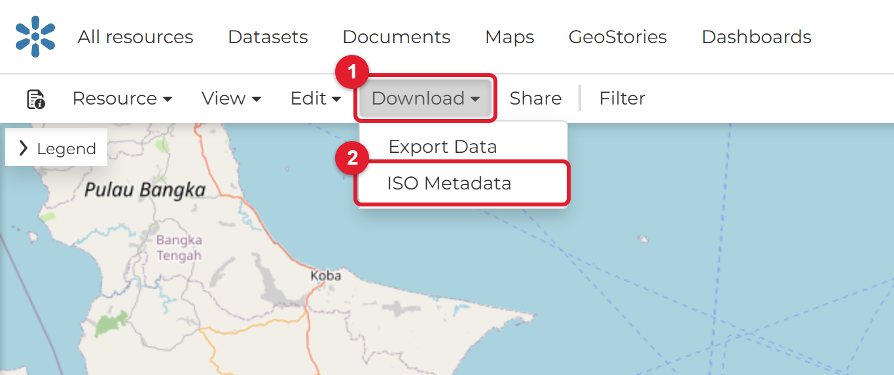
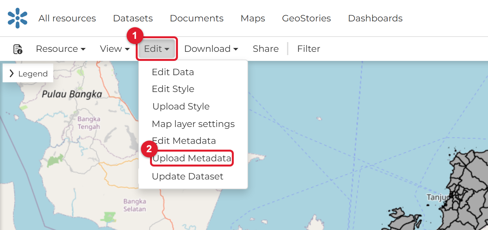
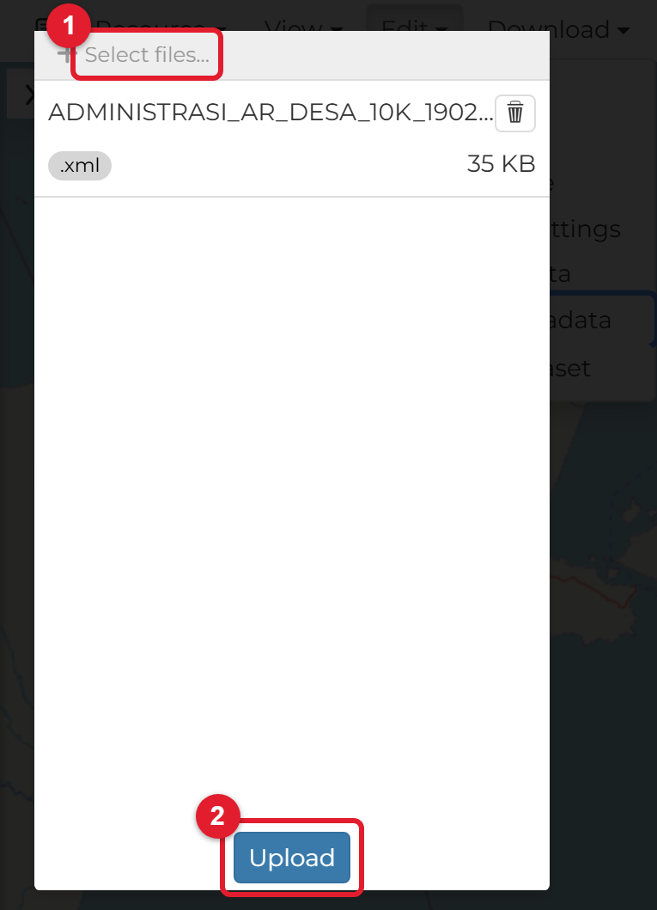
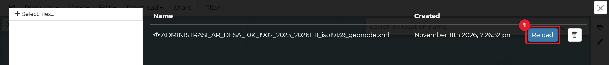

# Sesi 14 – Unggah metadata lewat web GeoNode

**Tujuan:** melengkapi metadata dataset yang sudah ada di GeoNode memakai halaman web GeoNode dan GeoMDB, tanpa
login dari QGIS.
**Waktu:** ±30 menit.
**Untuk:** produsen data yang mengunggah dataset ke GeoNode instansi (GeoNode 4.4 atau 5.x).

Alur ini cocok untuk bimbingan teknis karena hanya memakai browser dan QGIS. Alternatif langsung dari QGIS dibahas
di sesi 15–16.

```
GeoNode: Download › ISO Metadata ─► GeoMDB: Buka XML → lengkapi → Simpan → Export Untuk GeoNode
                                                                                    │
GeoNode: Edit › Upload Metadata ◄───────────────────────────────────────────────────┘
```

## Langkah

### 1. Unduh metadata dataset dari GeoNode

1. Login ke GeoNode di browser, buka halaman dataset Anda.
2. Klik **Download ▾ › ISO Metadata**, simpan berkas XML-nya (mis.
   `Batas_Wilayah_..._ISO_Metadata.xml`).



### 2. Lengkapi di GeoMDB

1. GeoMDB › **Buka XML Metadata…** › pilih berkas tadi. GeoMDB mengenali XML buatan GeoNode dan membersihkan teks
   pengisinya ([sesi 03](03-memulai-metadata.md#c-buka-xml-metadata)).
2. Lengkapi tahapan 1–13 (sesi 04–11). **Metadata Identifier** berisi UUID dataset GeoNode; biarkan.
3. **📁 Simpan Sebagai…**: simpan berkas ISO 19115-3 sebagai **arsip** dengan nama baru agar berkas unduhan asli
   tidak tertimpa.
4. **🌐 Export ISO 19139 (gmd) ▾ › Untuk GeoNode – Upload Metadata (dengan deklarasi XML)…** › simpan berkas
   `…_iso19139_geonode.xml`.

### 3. Unggah ke dataset yang sama di GeoNode

1. Di halaman dataset GeoNode klik **Edit ▾ › Upload Metadata**.

   

2. Klik **Select files…**, pilih berkas `…_iso19139_geonode.xml`, lalu klik **Upload**.

   

3. Setelah unggahan tercantum di daftar, klik **Reload** agar halaman dataset memuat metadata baru.

   

### 4. Periksa hasilnya

Buka **View Metadata** di halaman dataset, atau unduh lagi **Download › ISO Metadata**, lalu bandingkan dengan isian
Anda.

## Seberapa lengkap isi XML dipakai GeoNode?

Bergantung pada server GeoNode instansi:

| Server GeoNode | Hasilnya |
|---|---|
| GeoNode standar (belum ditambal) | GeoNode hanya mengambil kolom yang dikenalnya (judul, abstrak, kata kunci, tanggal, wilayah, dll.), lalu **membuat ulang** XML ISO dan record CSW dari templatenya. Lineage, laporan kualitas, tahap proses, sumber data, edisi, kredit, skala, dan kontak organisasi **tidak tampil**; kontak diganti akun pengunggah |
| GeoNode 5.x yang sudah memasang **tambalan unggah metadata UI** | XML Anda tersaji **lengkap** di CSW dan unduhan ISO. Halaman dataset menampilkan *Data Quality Statement* berisi lineage dan ringkasan laporan kualitas |

Tambalan server dipasang admin GeoNode memakai
[alat tambal GeoNode untuk GeoMDB](https://github.com/hariHK1/geonode-tambal-preserve). XML yang diunggah
**sebelum** server ditambal perlu diunggah ulang setelahnya.

Apa pun kondisinya, **simpan berkas ISO 19115-3 dari GeoMDB sebagai arsip**. Berkas itulah metadata lengkap Anda.

## Hal yang perlu diketahui

- **Tanggal dataset**: GeoNode mengisi tanggal dataset dari tanggal metadata (`dateStamp`) di XML. Periksa
  **Tanggal Metadata** di Tahap 1 sebelum mengekspor.
- **Metadata Identifier berbeda** dengan UUID dataset (mis. XML dibuat dari Template Kosong) tetap diterima lewat
  menu ini; UUID dataset GeoNode tidak berubah.
- **Izin**: menu **Upload Metadata** hanya muncul bila akun Anda boleh mengubah metadata dataset itu. Di server
  dengan alur persetujuan Walidata, dataset yang sudah diterbitkan biasanya tidak bisa lagi diubah produsen; minta
  Walidata mengembalikannya ke status belum terbit atau mengunggahkan XML-nya.

## Kondisi khusus & pesan galat

| Kondisi / pesan | Penyebab | Solusi |
|---|---|---|
| `Detected content type 'text/plain' does not match extension '.xml'` | XML tanpa baris deklarasi (hasil ekspor **Untuk Palapa / CSW**) | Ekspor ulang dengan **Untuk GeoNode** |
| `Unicode strings with encoding declaration are not supported` | Baris deklarasi memuat `encoding="UTF-8"` (XML dari aplikasi lain atau disunting manual) | Ekspor ulang dari GeoMDB dengan **Untuk GeoNode**, atau ubah baris pertama menjadi `<?xml version="1.0"?>` |
| Dataset berstatus *INVALID* setelah unggahan gagal | Pemrosesan XML gagal di GeoNode | Perbaiki XML-nya lalu unggah ulang; unggahan yang berhasil memulihkan status |
| Menu **Upload Metadata** tidak ada | Akun tidak punya izin ubah metadata, atau dataset sudah diterbitkan | Hubungi Walidata/admin GeoNode |
| GeoNode di balik Cloudflare menolak unggahan dari jaringan tertentu | Cek bot/WAF | Unggah dari browser biasa; bila tetap gagal, hubungi pengelola server |

**Lanjut ke:** [Sesi 15 – Login & ambil dari GeoNode](15-login-dan-ambil-dari-geonode.md)
